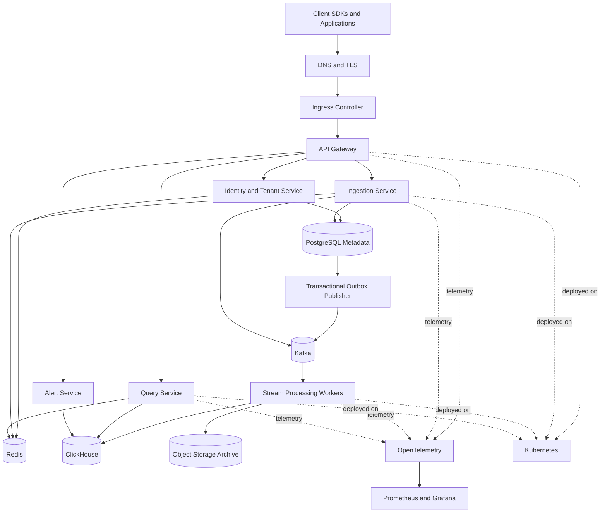

# NexusGrid

## Distributed Event Intelligence & Data Platform

NexusGrid is a production-inspired, multi-tenant platform for collecting application events, processing them asynchronously, storing analytical data, and exposing dashboards, alerting, and low-latency query APIs.

It combines the main ideas behind event ingestion platforms, stream processors, and analytical observability systems. Customers send events through an SDK or HTTP API; NexusGrid validates and routes them through Kafka; workers process and write them to ClickHouse; APIs serve tenant-isolated analytics; and platform telemetry exposes how the system itself behaves under load.

> **Status:** Architecture and development specification. Performance claims are targets until verified by reproducible benchmark reports.

---

## Why NexusGrid

NexusGrid is designed as a single coherent distributed-systems project rather than a collection of unrelated technologies. It demonstrates:

- High-throughput API ingestion and batching
- Kafka partitioning, consumer groups, replay, retries, and dead-letter queues
- Transactional metadata in PostgreSQL and analytical workloads in ClickHouse
- Redis-backed rate limits, idempotency, quotas, and query caching
- Multi-tenant authorization and data isolation
- Docker, Kubernetes, Helm, infrastructure-as-code, TLS, ingress, and autoscaling
- Metrics, traces, dashboards, load tests, failure drills, and recovery procedures

---

## Product Capabilities

### Event ingestion

- Single-event and batch REST ingestion APIs
- Tenant API keys and project-scoped authentication
- Versioned event-schema validation
- Payload-size, event-count, and quota limits
- Per-tenant rate limiting and backpressure responses
- Idempotency keys and bounded deduplication windows
- Explicit acknowledgement and delivery semantics

### Stream processing

- Kafka topics partitioned for horizontal consumption
- Consumer groups with independently scalable workers
- Retriable and non-retriable error classification
- Retry topics with controlled delay policy
- Dead-letter queue capture and replay tooling
- Idempotent writes and reconciliation jobs

### Analytics and querying

- Time-range filtering and tenant-scoped aggregation
- Error counts, request rates, latency percentiles, active-user and business-event metrics
- Pagination and cardinality safeguards
- Query cost limits and timeout protection
- Redis cache for bounded, repeatable query results
- ClickHouse materialized views for common aggregate workloads

### Operations

- Service health, readiness, and liveness checks
- Prometheus metrics and Grafana dashboards
- OpenTelemetry traces across ingestion, Kafka processing, and query execution
- Kubernetes deployment manifests and Helm charts
- Infrastructure provisioned through Terraform
- Runbooks for consumer lag, failed writes, expensive queries, and service recovery

---

## Architecture



---

## Event Lifecycle

1. A client application sends a signed request to the ingestion endpoint.
2. The API gateway authenticates the tenant and applies request-level controls.
3. The ingestion service validates the event envelope and event schema.
4. Redis enforces quotas, rate limits, and a bounded idempotency or deduplication window.
5. The service publishes the event to a tenant-aware Kafka topic or partition key.
6. Stream workers consume, validate, transform, and batch records.
7. Workers write analytical records to ClickHouse and optionally archive raw records to object storage.
8. Query APIs read tenant-scoped aggregates from ClickHouse, using Redis only for safe, short-lived cache entries.
9. Monitoring records throughput, latency, errors, consumer lag, database health, and query costs.

---

## Delivery Guarantees

NexusGrid does **not** claim an end-to-end distributed ACID transaction across PostgreSQL, Kafka, ClickHouse, Redis, and object storage.

The initial guarantee should be documented as:

> **At-least-once processing with idempotent downstream writes, bounded deduplication, replay support, and reconciliation.**

This requires:

- A durable outbox for metadata-driven events that must be published after PostgreSQL commits
- Stable event identifiers
- Consumer-side idempotency or deduplication strategy
- Retry classification and dead-letter queues
- Replay tooling and reconciliation reports
- Documented duplicate, ordering, and late-event behaviour

Exactly-once should not be claimed unless measured and proven for a defined scope.

---

## Data Stores and Responsibilities

| System | Responsibility | Must not be used as |
|---|---|---|
| PostgreSQL | Tenants, users, API keys, projects, schemas, dashboards, alert rules, audit logs, shard map | High-volume analytical event store |
| Kafka | Durable event transport, partitioning, replay, stream decoupling | Query database or transactional source of truth |
| ClickHouse | Event analytics, time-window aggregation, percentile queries, materialized views | User identity or transactional state store |
| Redis | Rate limits, quota counters, short dedupe keys, safe query cache | Durable source of truth |
| S3-compatible object storage | Raw archive, replay source, backup exports | Real-time query path |

---

## Core Data Model

### PostgreSQL metadata entities

- `tenants`
- `users`
- `projects`
- `api_keys`
- `event_schemas`
- `ingestion_jobs`
- `dashboards`
- `alert_rules`
- `audit_logs`
- `shard_map`

Use foreign keys, unique constraints, composite indexes, transactions, and cursor pagination. Record audit events for security-sensitive changes such as API-key creation, revocation, and alert-rule edits.

### Canonical event envelope

```json
{
  "event_id": "01J...",
  "tenant_id": "tenant_123",
  "project_id": "project_456",
  "event_name": "checkout.completed",
  "occurred_at": "2026-10-20T12:00:00Z",
  "received_at": "2026-10-20T12:00:01Z",
  "schema_version": 1,
  "idempotency_key": "client-generated-key",
  "properties": {
    "latency_ms": 152,
    "status_code": 200
  }
}
```

The schema version and event identifier are mandatory. Event payload validation must be deterministic and versioned.

### ClickHouse event table design

Start with a `MergeTree` table partitioned by a time period appropriate to data volume, sorted for common tenant-and-time queries. Typical query patterns should drive the ordering key, such as tenant, project, event time, and event name. Add materialized views only after measuring a real query bottleneck.

---

## API Surface

Initial endpoints:

```text
POST   /v1/events
POST   /v1/events:batch
GET    /v1/query/events
GET    /v1/query/metrics
POST   /v1/alerts
GET    /v1/alerts
POST   /v1/api-keys
DELETE /v1/api-keys/{id}
```

All endpoints require tenant context. Query endpoints require:

- Explicit time range
- Project scope
- Filter count and cardinality limits
- Maximum result size
- Cursor pagination where applicable
- Timeout and cost-budget controls

Publish OpenAPI contracts before client SDKs.

---

## Security and Multi-Tenancy

- Authenticate every request with tenant-scoped API keys or signed tokens.
- Hash API keys at rest and allow revocation and rotation.
- Enforce tenant ID at the boundary and verify it again in service layers.
- Include tenant context in PostgreSQL, Kafka, ClickHouse, Redis, object-storage, and audit access patterns.
- Test cross-tenant isolation automatically.
- Use Kubernetes Secrets or an external secret manager; never store production secrets in Git.
- Apply network policies and least-privilege service accounts in Kubernetes.

---

## Technology Stack

| Layer | Technology | Main responsibility |
|---|---|---|
| Services and SDK | TypeScript, Node.js, OpenAPI | APIs, contracts, SDKs, validation |
| Metadata | PostgreSQL | Transactional tenant and product state |
| Event backbone | Kafka | Partitioned event transport and replay |
| Analytics | ClickHouse | Columnar event analytics |
| Cache and limits | Redis | Rate limits, quotas, cache, dedupe window |
| Archive | S3-compatible storage | Raw event retention and recovery exports |
| Containers | Docker | Reproducible service images |
| Orchestration | Kubernetes and Helm | Deployment, scaling, service discovery |
| Edge | Ingress controller, DNS, TLS | Routing and certificate management |
| Infrastructure | Terraform | Repeatable cloud infrastructure |
| Observability | Prometheus, Grafana, OpenTelemetry | Metrics, dashboards, traces |
| Testing | Unit, integration, k6, failure tests | Functional and resilience validation |

---

## Local Development and Production Progression

### Local MVP

Run one local instance of PostgreSQL, Kafka, ClickHouse, Redis, and object storage through Docker Compose or equivalent. Build only:

- Tenant and API-key authentication
- Single and batch ingestion
- Kafka publishing and a worker
- ClickHouse event writes
- One time-range aggregate query
- Metrics and a basic dashboard

### Production-inspired evolution

After the MVP is stable:

1. Add retry, DLQ, replay, idempotency, and reconciliation.
2. Add tenant isolation and query-cost protection.
3. Add materialized views, caching, and alert evaluation.
4. Containerize and deploy services to Kubernetes.
5. Add ingress, DNS, TLS, autoscaling, network policies, and Helm.
6. Provision cloud infrastructure through Terraform.
7. Run load, failure, backup, restore, and scaling experiments.

---

## Measurable Success Criteria

NexusGrid must be judged by reproducible evidence, not architecture diagrams.

| Area | Required evidence |
|---|---|
| Ingestion | k6 report showing sustained events per second, p50/p95/p99 latency, and error rate |
| Kafka | Consumer-lag dashboard, retry behaviour, DLQ capture, and replay test |
| Reliability | Duplicate-event, worker-crash, and transient ClickHouse failure tests |
| Database | PostgreSQL query plans, ClickHouse query profiles, and materialized-view comparison |
| Multi-tenancy | Automated tests proving cross-tenant access is denied |
| Kubernetes | Rolling update, restart recovery, autoscaling, probes, and resource-limit evidence |
| Networking | HTTPS endpoint, ingress routing, certificate renewal evidence |
| Recovery | Tested backup and restore procedure with RPO and RTO targets |

Begin with a controlled target such as **1,000 events per second**. Increase load only after collecting evidence and identifying the next bottleneck. Do not claim millions of events per second without a published, reproducible benchmark.

---

## Repository Layout

```text
nexusgrid/
├── apps/
│   ├── api-gateway/
│   ├── auth-service/
│   ├── ingestion-service/
│   ├── query-service/
│   ├── alert-service/
│   └── dashboard/
├── workers/
│   ├── event-processor/
│   ├── outbox-publisher/
│   └── reconciliation-worker/
├── packages/
│   ├── contracts/
│   ├── sdk-node/
│   ├── config/
│   └── observability/
├── infra/
│   ├── compose/
│   ├── helm/
│   ├── kubernetes/
│   └── terraform/
├── docs/
│   ├── DEVELOPMENT.md
│   ├── architecture.md
│   ├── delivery-guarantees.md
│   ├── data-contracts.md
│   ├── runbooks/
│   └── benchmarks/
├── tests/
│   ├── integration/
│   ├── load/
│   ├── contract/
│   └── failure/
└── README.md
```

---

## Non-Goals for the First Release

- Global multi-region replication
- End-to-end exactly-once processing claims
- Automatic cross-shard joins at unlimited scale
- Arbitrary ad-hoc SQL for tenants
- Self-hosting every data system inside Kubernetes
- Unmeasured claims of million-event-per-second throughput

---

## Development Roadmap

See [DEVELOPMENT.md](./NexusGrid_DEVELOPMENT.md) for phase-by-phase implementation tasks, dependencies, verification gates, benchmark requirements, and evidence artifacts.

---

## License and Security

Choose a license before public release. Report security vulnerabilities privately and rotate exposed API keys immediately.
