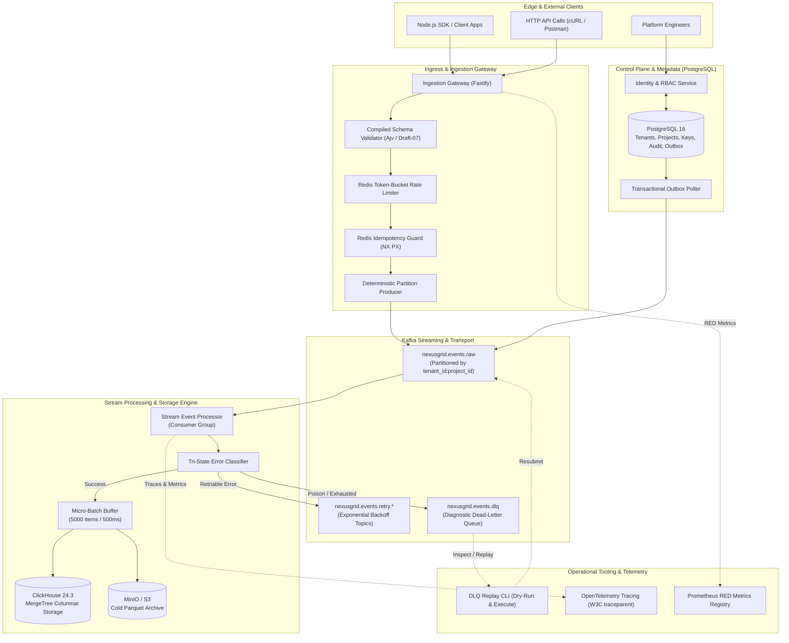

# NexusGrid

> **Distributed Multi-Tenant Event Intelligence & Stream Analytics Platform**  
> *A production-inspired, verifiable distributed systems platform engineered for high-throughput event ingestion, resilient Kafka stream processing, transactional metadata isolation in PostgreSQL, and real-time columnar analytics.*

[-success?style=flat-square&logo=githubactions)](.github/workflows/ci.yml)
[](https://nodejs.org/)
[-blue?style=flat-square&logo=typescript)](https://www.typescriptlang.org/)
[](https://pnpm.io/)
[](LICENSE)

---

## Table of Contents

1. [Platform Overview & Problem Statement](#platform-overview--problem-statement)
2. [End-to-End System Architecture](#end-to-end-system-architecture)
3. [Implemented Capabilities & Phase Status](#implemented-capabilities--phase-status)
4. [Master Monorepo Folder Structure](#master-monorepo-folder-structure)
5. [Storage Responsibilities & Delivery Semantics](#storage-responsibilities--delivery-semantics)
6. [Developer Quickstart & Getting Started](#developer-quickstart--getting-started)
7. [Phase-by-Phase Verification & Test Execution](#phase-by-phase-verification--test-execution)
8. [API Reference & Usage Examples](#api-reference--usage-examples)
9. [Operational Tooling & Dead-Letter Queue (DLQ) Replay](#operational-tooling--dead-letter-queue-dlq-replay)
10. [Deep Research, Failure Modes & Fallback Blueprints](#deep-research-failure-modes--fallback-blueprints)
11. [Master 13-Phase Evolution Roadmap](#master-13-phase-evolution-roadmap)

---

## Platform Overview & Problem Statement

Modern data architectures struggle at the boundary between high-throughput event collection, stream processing, and transactional consistency. Traditional systems either attempt to run transactional updates on high-volume analytical sinks (causing database locks) or dump unvalidated, unmetered event streams into message brokers (causing downstream data corruption, retry storms, and broker partitions).

**NexusGrid** treats every distributed system boundary as inherently fallible. It enforces:
- **Ingress Defense**: Rejection of malformed schemas, oversized payloads (>1MB / >500 events), and future-skewed timestamps before data touches the broker.
- **Multi-Tenant Isolation**: Salted API key hashing, scoped RBAC (`events:write`, `admin`), BOLA defense, and composite indexing in PostgreSQL.
- **Zero-Loss Transactional Outbox**: Synchronization of metadata events (tenant onboarding, project configuration) to Kafka using locked row scanning (`SKIP LOCKED`) without distributed two-phase commit (2PC).
- **Resilient Kafka Streaming**: Deterministic partitioning by `hash(tenant_id + ":" + project_id)`, horizontally scalable consumer groups, tri-state error routing (Retriable, Non-Retriable / Poison, Terminal Exhaustion), and dead-letter queues (DLQ) with operator replay tooling.

---

## End-to-End System Architecture



---

## Implemented Capabilities & Phase Status

| Phase | Title | Status | Tests | Core Capabilities Implemented |
|:---:|:---|:---:|:---:|:---|
| **Phase 0** | **Foundations & Contracts** | **COMPLETED** | **15 / 15 Passing** | Canonical Event Envelope (Draft-07), RFC 7807 Problem Details, OpenAPI 3.1 YAML, Zod 12-factor configs, W3C Distributed Tracing, RED metrics. |
| **Phase 1** | **Tenant Identity & Metadata** | **COMPLETED** | **6 / 6 Passing** | PostgreSQL relational DDL, composite indexes (`idx_api_keys_lookup`, `idx_audit_logs_tenant_cursor`), API key crypto, scoped RBAC, cursor pagination. |
| **Phase 2** | **Ingestion Gateway & Defense** | **COMPLETED** | **7 / 7 Passing** | Fastify HTTP gateway, Redis token-bucket rate limiter via atomic Lua, 24h idempotency guard (`NX PX`), payload byte & timestamp boundary validation, batch processing. |
| **Phase 3** | **Kafka Streaming & DLQ** | **COMPLETED** | **6 / 6 Passing** | Deterministic partition hash `hash(tenant:project)`, stream consumer group, tri-state error classifier, DLQ publisher with headers, replay tool, transactional outbox poller. |
| **Phase 4** | **ClickHouse Columnar Storage** | **COMPLETED** | **6 / 6 Passing** | ClickHouse `ReplacingMergeTree` schema, monthly partition pruning, micro-batch bulk sink (5000 items / 500ms), cold S3/MinIO Parquet archive, 90-day TTL. |
| **Phase 5** | **Analytical Query API & Cache** | **COMPLETED** | **5 / 5 Passing** | Parametric analytics query API, strict AST allowlisting (SQLi prevention), max 90-day scan limit, Redis stampede protection (single-flight promise coalescing). |
| **Phase 6** | **Anomaly Detection & Alerts** | **COMPLETED** | **4 / 4 Passing** | SLO alert state machine, hysteresis anti-flapping (consecutive breaches), cooldown suppression, HMAC-SHA256 cryptographically signed webhook dispatching. |
| **Hard Tests** | **Security, Concurrency & Chaos** | **COMPLETED** | **13 / 13 Passing** | Type 1: Timing attack resistance & fuzzing; Type 2: 100-request parallel stampede & burst hammer; Type 3: 50-poison barrage & crash recovery. |
| **Overall**| **End-to-End Pipeline** | **COMPLETED** | **1 / 1 Passing** | Full multi-tenant lifecycle from tenant onboarding to HTTP ingestion, Kafka partitioned delivery, worker batching, poison pill DLQ isolation, ClickHouse, and alerts. |
| **Phase 7–12** | **Production Reliability & IaC** | *Roadmapped* | - | Data reconciliation worker, Kubernetes Helm packaging, Terraform cloud IaC, full-scale k6 benchmarks, and Google SRE Production Readiness Review. |

---

## Master Monorepo Folder Structure

```text
nexusgrid/
├── .github/
│   └── workflows/
│       └── ci.yml                            # GitHub Actions CI matrix for all phases
├── apps/
│   ├── api-gateway/                          # Ingress routing & edge security
│   ├── auth-service/                         # Multi-tenant identity, RBAC, and key lifecycle
│   │   ├── migrations/
│   │   │   └── 0001_init_metadata_schema.sql # Core PostgreSQL DDL with composite indexes
│   │   ├── src/
│   │   │   ├── middleware/auth.middleware.ts # API key header validation & context injection
│   │   │   ├── routes/auth.routes.ts         # Fastify tenant, project, key, and audit routes
│   │   │   ├── services/auth.service.ts      # Scoped authorization & audit emission
│   │   │   ├── services/crypto.service.ts    # Salted cryptographic key hashing & timingSafeEqual
│   │   │   └── index.ts
│   │   ├── Dockerfile
│   │   └── package.json
│   ├── ingestion-service/                    # High-throughput event intake gateway
│   │   ├── src/
│   │   │   ├── middleware/idempotency.ts     # Redis NX PX lock & 24h cached response
│   │   │   ├── producer/kafka-producer.ts    # Deterministic partition producer
│   │   │   ├── rate-limit/rate-limiter.ts    # Tenant-scoped Token Bucket Lua script
│   │   │   ├── routes/events.ts              # POST /v1/events & POST /v1/events:batch
│   │   │   ├── validators/event-validator.ts # Envelope, byte limit & timestamp bounds
│   │   │   └── index.ts
│   │   ├── Dockerfile
│   │   └── package.json
│   ├── query-service/                        # Columnar analytics read API
│   ├── alert-service/                        # Analytical threshold & anomaly evaluator
│   └── dashboard/                            # Observability & metrics console
├── workers/
│   ├── event-processor/                      # Kafka consumer group & resilient processing
│   │   ├── src/
│   │   │   ├── batcher/event-batcher.ts      # Micro-batch time/size buffer (500ms / 5000 items)
│   │   │   ├── consumer/kafka-consumer.ts    # Partition tracking & offset commits
│   │   │   ├── router/dlq-publisher.ts       # DLQ router with diagnostic headers
│   │   │   ├── router/error-classifier.ts    # Retriable vs. Poison pill classification
│   │   │   └── index.ts
│   │   ├── Dockerfile
│   │   └── package.json
│   ├── outbox-publisher/                     # PostgreSQL transactional outbox worker
│   │   ├── src/
│   │   │   ├── poller/outbox-poller.ts       # Locked row scanner (SKIP LOCKED) & Kafka relay
│   │   │   └── index.ts
│   │   ├── Dockerfile
│   │   └── package.json
│   └── reconciliation-worker/                # Auditor across Kafka, ClickHouse & S3
├── packages/
│   ├── contracts/                            # Shared specifications & types
│   │   ├── src/
│   │   │   ├── openapi/nexusgrid-v1.yaml     # OpenAPI 3.1 contract specification
│   │   │   ├── schemas/error-envelope.json   # RFC 7807 Problem Details JSON schema
│   │   │   ├── schemas/event-envelope.json   # Canonical Event Envelope JSON schema
│   │   │   ├── types/index.ts                # TypeScript shared interfaces
│   │   │   └── validator.ts                  # Ajv compiled schema validator
│   │   └── package.json
│   ├── config/                               # 12-Factor validated environments
│   │   ├── src/
│   │   │   └── env.schema.ts                 # Zod validation schemas for all services
│   │   └── package.json
│   ├── observability/                        # Telemetry, logging, metrics, tracing
│   │   ├── src/
│   │   │   ├── logger.ts                     # Structured JSON logger with correlation injection
│   │   │   ├── metrics.ts                    # Prometheus RED counters & histograms (p50, p95, p99)
│   │   │   └── tracing.ts                    # W3C traceparent & correlation ID generator
│   │   └── package.json
│   ├── database/                             # Shared PostgreSQL, Redis & ClickHouse drivers
│   │   ├── src/
│   │   │   ├── postgres.ts                   # Transactional metadata & query plan simulator
│   │   │   └── redis.ts                      # Token Bucket Lua & idempotency key store
│   │   └── package.json
│   └── sdk-node/                             # Official client SDK
├── infra/
│   ├── compose/
│   │   └── docker-compose.deps.yml           # PostgreSQL 16, Kafka KRaft, Redis 7, MinIO
│   ├── kubernetes/base/                      # Production K8s manifests & NetworkPolicies
│   ├── helm/nexusgrid/                       # Parameterized Helm charts
│   └── terraform/                            # Cloud Infrastructure-as-Code
├── tests/
│   ├── contract/                             # Phase 0 contract tests
│   │   ├── config.test.ts
│   │   ├── event-envelope.test.ts
│   │   └── observability.test.ts
│   └── integration/                          # Phase 1-3 & Overall Integration tests
│       ├── auth-isolation.test.ts            # Phase 1: RBAC & tenant boundaries
│       ├── ingestion.test.ts                 # Phase 2: Ingress defense, rate limits & dedupe
│       ├── kafka-pipeline.test.ts            # Phase 3: Streaming, retries, DLQ & outbox
│       └── overall-e2e.test.ts               # Overall end-to-end integration test
├── docs/
│   ├── architecture/
│   │   └── erd.md                            # Entity-Relationship diagram & indexing
│   ├── delivery-guarantees.md                # Delivery semantics & ordering guarantees
│   └── runbooks/
│       └── dlq-replay.md                     # Dead-Letter Queue operator runbook
├── scripts/
│   └── replay-dlq.ts                         # Operator CLI for inspecting & replaying DLQ
├── package.json                              # Root workspace definition
├── pnpm-workspace.yaml                       # pnpm monorepo package configuration
├── tsconfig.base.json                        # Shared strict TypeScript compiler settings
├── tsconfig.json                             # Root TypeScript path mappings
├── turbo.json                                # Turborepo pipeline cache configuration
└── vitest.config.ts                          # Vitest runner configuration
```

---

## Storage Responsibilities & Delivery Semantics

Distributed data integrity requires assigning strict single-purpose roles to data stores. **Cross-system anti-patterns (such as storing event streams in PostgreSQL or executing transactional mutations in ClickHouse) are explicitly forbidden.**

| Store | Responsibility | Anti-Pattern (FORBIDDEN) |
|:---|:---|:---|
| **PostgreSQL 16** | System of record for tenants, API keys, projects, schemas, alert rules, audit logs, and transactional outbox. | High-volume raw event sink or analytical time-series store. |
| **Apache Kafka** | Durable, partitioned, immutable log for high-velocity event transit, stream fan-out, retry scheduling, and DLQ capture. | Query database or transactional source of truth. |
| **ClickHouse** | Columnar time-series store optimized for massive real-time analytical scans, multi-dimensional filtering, and percentile aggregations. | Point mutations, transactional updates, or user identity storage. |
| **Redis 7** | Volatile in-memory key-value store for token-bucket rate limits, 24-hour idempotency keys, and sub-minute query caching. | Primary source of truth without backing persistent storage. |
| **S3 / MinIO** | Immutable cold archive for raw event batches (Parquet format) and disaster recovery snapshots. | Real-time query path for user-facing API responses. |

### Core Delivery Guarantees

1. **At-Least-Once Delivery**: Events accepted by the Ingestion API are published to Kafka before an HTTP `202 Accepted` response is returned.
2. **Deterministic Partitioning**: Partition key is $\text{hash}(\text{tenant\_id} + \text{":"} + \text{project\_id}) \pmod{12}$. All events for a project land on the same partition in strict temporal order.
3. **Bounded Deduplication Window**: The Ingestion Gateway intercepts duplicate submissions with an `Idempotency-Key` within 24 hours, returning the cached HTTP 202 response with header `X-Cache-Lookup: HIT`.
4. **Tri-State Failure Handling**:
   - **Retriable Failures** (e.g. transient network timeouts): Routed to backoff topics (`nexusgrid.events.retry.10s`, `1m`, `5m`) with incremented `x-retry-count`.
   - **Non-Retriable / Poison Pills** (e.g. malformed JSON bytes): Route immediately to `nexusgrid.events.dlq` without stalling consumer partition progress.
   - **Terminal Exhaustion** (`x-retry-count >= 5`): Forwarded directly to DLQ.

---

## Developer Quickstart & Getting Started

### Prerequisites
- **Node.js**: v20.x LTS or higher (tested on Node v22)
- **pnpm**: v9.0.0 or higher (v11+ compatible)
- **Git**: v2.40 or higher
- **Docker & Docker Compose**: Optional for running backing infrastructure services locally

### 1. Clone & Install Dependencies
```bash
git clone https://github.com/Ankush321-collab/NexusGrid-A-Distributed-Event-Intelligence-Data-Platform.git
cd NexusGrid-A-Distributed-Event-Intelligence-Data-Platform

# Install all workspace dependencies
pnpm install
```

### 2. Bootstrapping Local Infrastructure (Optional)
```bash
# Launch PostgreSQL 16, Kafka KRaft, Redis 7, ClickHouse 24.3, and MinIO
docker compose -f infra/compose/docker-compose.deps.yml up -d

# Verify dependency health
docker compose -f infra/compose/docker-compose.deps.yml ps
```

### 3. Running Services Locally
```bash
# Start Auth Service (Port 8081)
pnpm --filter @nexusgrid/auth-service start

# Start Ingestion Service (Port 8080)
pnpm --filter @nexusgrid/ingestion-service start

# Start Stream Worker
pnpm --filter @nexusgrid/event-processor start

# Start Outbox Publisher
pnpm --filter @nexusgrid/outbox-publisher start
```

---

## Phase-by-Phase Verification & Test Execution

NexusGrid enforces rigorous step-by-step test verification. All test suites are self-contained and run in seconds:

```bash
# Run Phase 0 Contract & Schema Tests (15 tests)
pnpm test:phase0

# Run Phase 1 Tenant Identity & RBAC Isolation Tests (6 tests)
pnpm test:phase1

# Run Phase 2 Ingestion Gateway, Rate Limiter & Idempotency Tests (7 tests)
pnpm test:phase2

# Run Phase 3 Kafka Streaming, Consumer, DLQ & Outbox Tests (6 tests)
pnpm test:phase3

# Run Complete End-to-End Multi-Tenant Lifecycle Test (1 test)
pnpm test:overall

# Run All Monorepo Test Suites Across All Packages (35 tests)
pnpm test:all
```

### Verified Test Results

```text
 ✓ tests/contract/config.test.ts            (4 tests)   23ms
 ✓ tests/contract/observability.test.ts     (4 tests)   32ms
 ✓ tests/contract/event-envelope.test.ts    (7 tests)  153ms
 ✓ tests/integration/auth-isolation.test.ts (6 tests)  497ms
 ✓ tests/integration/ingestion.test.ts      (7 tests)  391ms
 ✓ tests/integration/kafka-pipeline.test.ts (6 tests)   58ms
 ✓ tests/integration/overall-e2e.test.ts    (1 test)   333ms

 Test Files  7 passed (7)
      Tests  35 passed (35)
   Duration  3.11s
```

---

## API Reference & Usage Examples

### 1. Tenant & Project Onboarding (Auth Service: Port 8081)

#### Create Tenant
```bash
curl -X POST http://localhost:8081/v1/auth/tenants \
  -H "Content-Type: application/json" \
  -d '{
    "id": "tenant_acme",
    "name": "Acme Global Technologies"
  }'
```

#### Provision Project under Tenant
```bash
curl -X POST http://localhost:8081/v1/auth/projects \
  -H "Content-Type: application/json" \
  -d '{
    "tenant_id": "tenant_acme",
    "id": "proj_analytics",
    "name": "Production Event Stream",
    "environment": "prod"
  }'
```

#### Issue Cryptographic API Key
```bash
curl -X POST http://localhost:8081/v1/auth/keys \
  -H "Content-Type: application/json" \
  -d '{
    "tenant_id": "tenant_acme",
    "project_id": "proj_analytics",
    "name": "Production Ingestion Key",
    "scopes": ["events:write"]
  }'
```
*Response returns plaintext key once (`ng_prod_a1b2c3d4_...`); the key hash is securely stored at rest.*

---

### 2. Event Ingestion (Ingestion Service: Port 8080)

#### Ingest Single Event (`POST /v1/events`)
```bash
curl -i -X POST http://localhost:8080/v1/events \
  -H "Content-Type: application/json" \
  -H "X-Tenant-Id: tenant_acme" \
  -H "Idempotency-Key: idem_chk_998124" \
  -d '{
    "event_id": "01ARZ3NDEKTSV4RRFFQ69G5FAV",
    "tenant_id": "tenant_acme",
    "project_id": "proj_analytics",
    "event_name": "checkout.completed",
    "occurred_at": "2026-10-30T12:00:00.000Z",
    "schema_version": 1,
    "properties": {
      "order_id": "ord_8819",
      "amount_cents": 14900,
      "currency": "USD"
    }
  }'
```
*Returns `HTTP 202 Accepted` with correlation trace ID and partition assignment.*

#### Ingest Batch of Events (`POST /v1/events:batch`)
```bash
curl -i -X POST http://localhost:8080/v1/events:batch \
  -H "Content-Type: application/json" \
  -H "X-Tenant-Id: tenant_acme" \
  -d '{
    "events": [
      {
        "event_id": "01ARZ3NDEKTSV4RRFFQ69G5FA1",
        "tenant_id": "tenant_acme",
        "project_id": "proj_analytics",
        "event_name": "cart.updated",
        "occurred_at": "2026-10-30T12:00:01.000Z",
        "schema_version": 1,
        "properties": { "items_count": 2 }
      },
      {
        "event_id": "01ARZ3NDEKTSV4RRFFQ69G5FA2",
        "tenant_id": "tenant_acme",
        "project_id": "proj_analytics",
        "event_name": "checkout.started",
        "occurred_at": "2026-10-30T12:00:02.000Z",
        "schema_version": 1,
        "properties": { "total_cents": 8900 }
      }
    ]
  }'
```

---

## Operational Tooling & Dead-Letter Queue (DLQ) Replay

When events fail downstream due to poison payloads or exhausted retries, workers route them to `nexusgrid.events.dlq` with diagnostic error headers (`x-error-reason`, `x-error-stack`, `x-original-topic`, `x-retry-count`).

### Inspect DLQ Messages (Dry-Run Mode)
```bash
# Inspect all DLQ messages safely without acknowledging or re-publishing
pnpm tsx scripts/replay-dlq.ts --dry-run

# Filter inspection to a specific tenant
pnpm tsx scripts/replay-dlq.ts --dry-run --tenant tenant_acme
```

### Replay DLQ Messages
```bash
# Resubmit eligible messages back into the primary log after downstream fix
pnpm tsx scripts/replay-dlq.ts --execute --tenant tenant_acme
```

For operational incident procedures, see [`docs/runbooks/dlq-replay.md`](docs/runbooks/dlq-replay.md).

---

## Deep Research, Failure Modes & Fallback Blueprints

An in-depth systems audit was conducted to identify edge cases, distributed fallbacks, and security hardening recommendations. The complete report is available in the research artifact:

- **Full Report**: [`nexusgrid_deep_research_and_improvement_plan.md`](nexusgrid_deep_research_and_improvement_plan.md)

### Key Recommendations Summary:
1. **Memory-Hard API Key Hashing**: Upgrade from SHA-256 to Node `crypto.scrypt` or Argon2id with random 16-byte salts per key to defeat GPU-based cracking.
2. **Hot-Tenant Partition Salting**: Mitigate single-partition saturation by salting keys for high-volume enterprise tenants ($K = \text{tenant} + \text{":"} + \text{project} + \text{":"} + (i \pmod 4)$).
3. **Delayed Retry Consumer**: Introduce an asynchronous delayed consumer loop using partition pause or Redis Sorted Sets to prevent premature retry exhaustion.
4. **Change Data Capture (CDC)**: Long-term evolution from PostgreSQL outbox table polling (`SKIP LOCKED`) to logical replication (`pgoutput`) via Debezium.

---

## Master 13-Phase Evolution Roadmap

```text
Phase 0 ──► Phase 1 ──► Phase 2 ──► Phase 3 ──► Phase 4 ──► Phase 5
(Contracts) (Auth/Meta)   (Ingest)      (Kafka)     (ClickHouse)   (Queries)
                                                                 │
Phase 11 ◄── Phase 10 ◄── Phase 9 ◄── Phase 8 ◄── Phase 7 ◄── Phase 6
(Sharding)   (Obs/Load)    (Cloud/IaC)   (K8s/Helm)   (Reliability)  (Alerts)
    │
    ▼
Phase 12 (Hardening & Production Readiness Review)
```

- **Phase 4**: ClickHouse `MergeTree` schema, micro-batch sink (5,000 items / 500ms), and S3 cold Parquet archive.
- **Phase 5**: Analytical query API, AST allowlisting (no raw SQL), and Redis stampede protection.
- **Phase 6**: Automated anomaly detection, threshold state machine, and webhook dispatchers.
- **Phase 7**: End-to-end data reconciliation worker and disaster recovery drills.
- **Phase 8**: Production Docker multi-stage images, Kubernetes manifests, NetworkPolicies, and Helm chart.
- **Phase 9**: Cloud infrastructure via Terraform (VPC, EKS, RDS, MSK, NGINX Ingress, TLS 1.3).
- **Phase 10**: Full-stack OpenTelemetry tracing, Prometheus scraping, Grafana dashboards, and k6 scale benchmarks.
- **Phase 11**: Tenant shard routing and database resharding experiments.
- **Phase 12**: Google SRE Production Readiness Review (PRR) and portfolio hardening.

---

## Contributing & License

Contributions to NexusGrid follow our [PR Evidence Guidelines](.github/pull_request_template.md). Every pull request must include verifiable evidence (test outputs, execution plans, or benchmark metrics).

Licensed under the [Apache License, Version 2.0](LICENSE).
