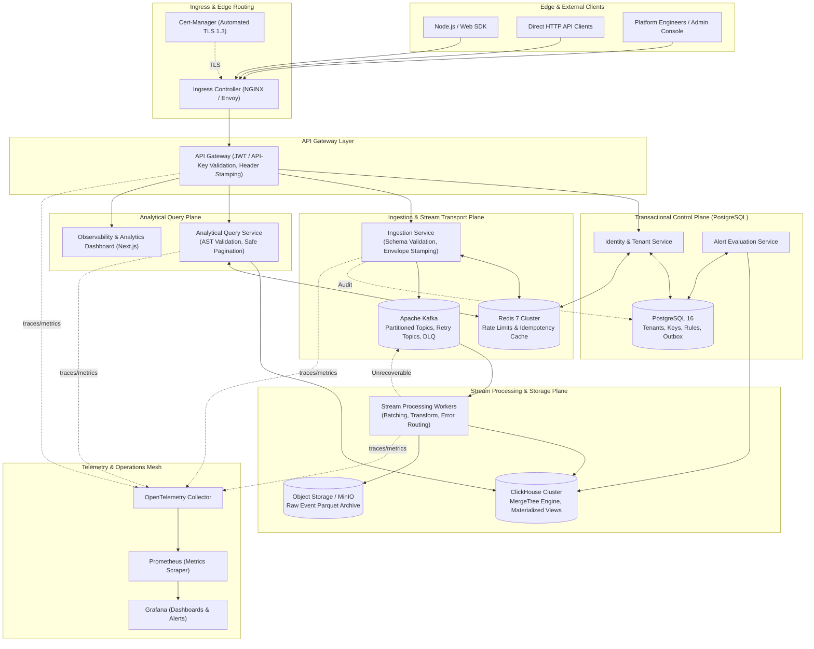

# NexusGrid

> **Distributed Multi-Tenant Event Intelligence & Stream Analytics Platform**
> 
> *A production-grade, verifiable distributed systems blueprint for high-throughput event ingestion, real-time stream processing, columnar time-series analytics, and automated SLO alerting.*

---

## Table of Contents

1. [Executive Summary & Platform Vision](#executive-summary--platform-vision)
2. [End-to-End System Architecture](#end-to-end-system-architecture)
3. [Storage Responsibilities & Delivery Semantics](#storage-responsibilities--delivery-semantics)
4. [Master Monorepo Folder Structure & Component Breakdown](#master-monorepo-folder-structure--component-breakdown)
5. [Comprehensive Technology Stack Matrix](#comprehensive-technology-stack-matrix)
6. [Phase-by-Phase Development Blueprint](#phase-by-phase-development-blueprint)
   - [Phase 0: Workspace Foundations, Tooling & Shared Contracts](#phase-0--workspace-foundations-tooling--shared-contracts)
   - [Phase 1: Multi-Tenant Identity, Access Control & Metadata Core](#phase-1--multi-tenant-identity-access-control--metadata-core)
   - [Phase 2: High-Throughput Ingestion Gateway & Ingress Defense](#phase-2--high-throughput-ingestion-gateway--ingress-defense)
   - [Phase 3: Kafka Streaming Backbone, Workers & Resilient Pipelines](#phase-3--kafka-streaming-backbone-workers--resilient-pipelines)
   - [Phase 4: ClickHouse Columnar Storage & Analytics Engine](#phase-4--clickhouse-columnar-storage--analytics-engine)
   - [Phase 5: Analytical Query API, AST Allowlisting & Cache Layer](#phase-5--analytical-query-api-ast-allowlisting--cache-layer)
   - [Phase 6: Anomaly Detection, Alerting Engine & Scheduled Aggregates](#phase-6--anomaly-detection-alerting-engine--scheduled-aggregates)
   - [Phase 7: Distributed Reliability, Data Reconciliation & Disaster Recovery](#phase-7--distributed-reliability-data-reconciliation--disaster-recovery)
   - [Phase 8: Containerization, Kubernetes Orchestration & Helm Packaging](#phase-8--containerization-kubernetes-orchestration--helm-packaging)
   - [Phase 9: Edge Networking, TLS, DNS & Cloud Infrastructure (Terraform)](#phase-9--edge-networking-tls-dns--cloud-infrastructure-terraform)
   - [Phase 10: Full-Stack Observability, OpenTelemetry & Scale Benchmarking](#phase-10--full-stack-observability-opentelemetry--scale-benchmarking)
   - [Phase 11: Database Sharding & High-Scale Distribution Experiments](#phase-11--database-sharding--high-scale-distribution-experiments)
   - [Phase 12: Production Readiness Review, Hardening & Portfolio Release](#phase-12--production-readiness-review-hardening--portfolio-release)
7. [Phase Evolution & Directory Implementation Map](#phase-evolution--directory-implementation-map)
8. [24-Week Master Implementation Schedule](#24-week-master-implementation-schedule)
9. [Developer Quickstart & Verification Guide](#developer-quickstart--verification-guide)
10. [References & Supplementary Specifications](#references--supplementary-specifications)

---

## Executive Summary & Platform Vision

NexusGrid is an enterprise-scale distributed event intelligence and analytics platform engineered to bridge the gap between high-throughput event ingestion, distributed streaming, and real-time analytical queries. 

Unlike toy microservice demonstrations, NexusGrid treats **every cross-system boundary as inherently fallible**. It is structured to prove correctness first, enforce strict multi-tenant boundaries at every persistence layer, provide verifiable at-least-once delivery with downstream deduplication, and withstand real-world operational failure scenarios (network partitions, worker crashes, database failovers, and poison-pill messages).

```
[ Client SDKs / Edge HTTP ]
           │
           ▼
[ Kong / Nginx API Gateway ]
           │ (Validate Auth, Envelope, Schema, Rate-Limit)
           ▼
[ Ingestion Service (Node.js/TS) ] ──(Transactional Outbox)──► [ PostgreSQL 16 ]
           │ (Durable Batch Publish)
           ▼
    [ Apache Kafka ] ◄── (Topic Partitioning by tenant_id + project_id)
           │
     ┌─────┴─────────────────────────┐
     ▼                               ▼
[ Stream Workers (Consumer Group) ]  [ Dead-Letter Queue (DLQ) & Replay ]
     │                               ▲ (Retries Exhausted)
     ├───────────────────────────────┤
     ▼ (Micro-batched idempotent writes)
[ ClickHouse Columnar Store ] ───► [ S3 / MinIO Raw Cold Archive ]
     ▲
     │ (Tenant-scoped aggregates, Materialized Views, Percentiles)
[ Query & Alert Services ] ◄──► [ Redis 7 (Cache-aside + Rate Limits) ]
```

---

## End-to-End System Architecture



---

## Storage Responsibilities & Delivery Semantics

Distributed data integrity requires assigning strict single-purpose roles to data stores. **Cross-system anti-patterns (such as storing event streams in PostgreSQL or running ad-hoc tenant CRUD in ClickHouse) are explicitly forbidden.**

| System | Canonical Role | Data Retention Policy | Strict Anti-Patterns (FORBIDDEN) |
|:---|:---|:---|:---|
| **PostgreSQL 16** | System of record for tenants, API keys, schema definitions, alert configurations, audit logs, and transactional outbox. | Permanent transactional history; audit logs retained for compliance (e.g. 7 years). | **NEVER** use as a high-volume event sink or time-series aggregation store. |
| **Apache Kafka** | Durable, partitioned, immutable log for high-velocity event transit, stream fan-out, retry scheduling, and DLQ capture. | 7-day retention on primary topics; 14-day retention on DLQ topics. | **NEVER** use as an analytical database or searchable query engine. |
| **ClickHouse** | Columnar time-series store optimized for massive real-time analytical scans, multi-dimensional filtering, and percentile aggregations. | 90–365 days hot storage via `MergeTree` TTL expressions; partition drop after expiry. | **NEVER** use for point mutations, transactional updates, or user identity storage. |
| **Redis 7** | Volatile in-memory key-value store for token-bucket rate limits, 24-hour idempotency keys, and sub-minute query caching. | Explicit TTL on every key (1 second to 24 hours); volatile-lru eviction. | **NEVER** use as a primary source of truth without backing persistent storage. |
| **S3 / MinIO** | Immutable cold archive for raw event batches (Parquet format), database backups, and historical disaster recovery replay. | Indefinite archival with Glacier/Cold transition lifecycle rules. | **NEVER** place in the real-time query path for user-facing API responses. |

### Documented Delivery Guarantees

1. **At-Least-Once Delivery**: Events accepted by the Ingestion API are durably published to Kafka before HTTP `202 Accepted` is returned.
2. **Deterministic Partitioning**: Events are partitioned by `hash(tenant_id + ":" + project_id)`. This guarantees total per-tenant, per-project ordering while enabling horizontal multi-core scale.
3. **Downstream Idempotency**: ClickHouse inserts leverage deterministic event identifiers (`event_id` generated via ULID / UUIDv7) and `ReplacingMergeTree` deduplication or worker-level deduplication tables.
4. **Resilient Failure Handling**: Non-retriable failures (e.g., malformed payloads) bypass retries and flow immediately to the Dead-Letter Queue (DLQ) with error headers. Retriable network blips are retried with exponential backoff and jitter.

---

## Master Monorepo Folder Structure & Component Breakdown

NexusGrid is organized as a high-discipline monorepo managed with **pnpm** and **Turborepo**. The folder structure is modular, enforcing clear dependency isolation between services, shared libraries, operational tools, and infrastructure.

```text
nexusgrid/
├── .github/                                # CI/CD workflows, issue templates, and PR checks
│   ├── workflows/
│   │   ├── ci.yml                          # Monorepo linting, type-checking, and unit tests
│   │   ├── integration.yml                 # Testcontainers-driven integration suite
│   │   ├── load-test.yml                   # Automated k6 baseline load benchmark
│   │   └── release.yml                     # Helm and Docker image build and push pipeline
│   └── pull_request_template.md            # Evidence-required pull request template
├── apps/                                   # Deployable microservices and web interfaces
│   ├── api-gateway/                        # Ingress gateway, routing, SSL termination, and JWT/Key auth
│   │   ├── src/
│   │   │   ├── middleware/                 # Rate-limiting, CORS, correlation-ID, and logging
│   │   │   ├── routes/                     # Proxy routes directing to downstream services
│   │   │   └── index.ts                    # Entrypoint
│   │   ├── Dockerfile                      # Non-root, multi-stage production container
│   │   └── package.json
│   ├── auth-service/                       # Multi-tenant identity, API key lifecycle, and RBAC
│   │   ├── src/
│   │   │   ├── domain/                     # Tenant, User, Project, and APIKey domain logic
│   │   │   ├── repositories/               # PostgreSQL metadata repositories (Kysely / Prisma)
│   │   │   ├── services/                   # Argon2 hashing, key rotation, and audit emission
│   │   │   └── index.ts
│   │   ├── migrations/                     # Flyway / SQL migration scripts for metadata schema
│   │   ├── Dockerfile
│   │   └── package.json
│   ├── ingestion-service/                  # High-throughput event validation and Kafka producer
│   │   ├── src/
│   │   │   ├── validators/                 # JSON Schema and envelope validation logic
│   │   │   ├── rate-limit/                 # Redis-backed token bucket algorithm
│   │   │   ├── producer/                   # High-efficiency batched Kafka producer
│   │   │   └── index.ts
│   │   ├── Dockerfile
│   │   └── package.json
│   ├── query-service/                      # Read API for ClickHouse time-series analytics
│   │   ├── src/
│   │   │   ├── query-builder/              # Safe AST query parser and parameter allowlisting
│   │   │   ├── cache/                      # Redis cache-aside manager with stampede protection
│   │   │   ├── client/                     # ClickHouse HTTP/Native connection pool
│   │   │   └── index.ts
│   │   ├── Dockerfile
│   │   └── package.json
│   ├── alert-service/                      # Rule engine evaluating analytical thresholds
│   │   ├── src/
│   │   │   ├── engine/                     # Evaluation state machine, hysteresis, and cooldowns
│   │   │   ├── notifiers/                  # Webhook, PagerDuty, and Email dispatchers
│   │   │   ├── scheduler/                  # Distributed cron / timer executor
│   │   │   └── index.ts
│   │   ├── Dockerfile
│   │   └── package.json
│   └── dashboard/                          # Production-grade Next.js 14 web application
│       ├── src/
│       │   ├── app/                        # Next.js App Router (analytics, keys, schemas, alerts)
│       │   ├── components/                 # Tailwind + Radix UI interactive data charts
│       │   └── lib/                        # NexusGrid SDK client integration
│       ├── Dockerfile
│       └── package.json
├── workers/                                # Asynchronous stream processors and background jobs
│   ├── event-processor/                    # Kafka consumer group micro-batching into ClickHouse
│   │   ├── src/
│   │   │   ├── consumer/                   # KafkaJS consumer with partition-aware assignment
│   │   │   ├── batcher/                    # High-throughput time/size buffer (e.g. 500ms or 5000 items)
│   │   │   ├── sink/                       # ClickHouse bulk inserter with retry handling
│   │   │   └── index.ts
│   │   ├── Dockerfile
│   │   └── package.json
│   ├── outbox-publisher/                   # Transactional outbox polling & CDC relay to Kafka
│   │   ├── src/
│   │   │   ├── poller/                     # High-frequency locked row scanner (`SKIP LOCKED`)
│   │   │   └── index.ts
│   │   ├── Dockerfile
│   │   └── package.json
│   └── reconciliation-worker/              # Auditor reconciling Kafka, ClickHouse & S3 counts
│       ├── src/
│       │   ├── auditor/                    # Gap detector across offsets, raw files, and rows
│       │   └── index.ts
│       ├── Dockerfile
│       └── package.json
├── packages/                               # Shared, versioned internal libraries
│   ├── contracts/                          # Canonical event schema, OpenAPI specs, and types
│   │   ├── src/
│   │   │   ├── schemas/                    # JSON Schema specifications for event envelopes
│   │   │   ├── openapi/                    # Versioned OpenAPI 3.1 YAML contracts
│   │   │   └── types/                      # Auto-generated TypeScript interfaces
│   │   └── package.json
│   ├── sdk-node/                           # Official TypeScript client SDK for event emission
│   │   ├── src/
│   │   │   ├── client.ts                   # NexusGridClient with local buffering & retries
│   │   │   └── index.ts
│   │   └── package.json
│   ├── config/                             # 12-Factor validated environment configurations
│   │   ├── src/
│   │   │   ├── env.schema.ts               # Zod validation schemas for all services
│   │   │   └── index.ts
│   │   └── package.json
│   ├── observability/                      # OpenTelemetry, Prometheus metrics, and Pino logger
│   │   ├── src/
│   │   │   ├── tracing.ts                  # TraceProvider and Jaeger/OTLP exporters
│   │   │   ├── metrics.ts                  # Prometheus registry with pre-baked RED metrics
│   │   │   ├── logger.ts                   # Structured JSON logger with correlation injection
│   │   │   └── index.ts
│   │   └── package.json
│   └── database/                           # Shared DB connections, connection pools, and ORM
│       ├── src/
│       │   ├── postgres.ts                 # PostgreSQL connection pool with health probes
│       │   ├── clickhouse.ts               # ClickHouse client pool
│       │   └── redis.ts                    # Redis cluster client with sentinel/failover
│       └── package.json
├── infra/                                  # Infrastructure-as-code and orchestration
│   ├── compose/                            # Multi-container local environments
│   │   ├── docker-compose.base.yml         # Shared networking and volume declarations
│   │   ├── docker-compose.deps.yml         # Local Postgres, Kafka, ClickHouse, Redis, MinIO
│   │   ├── docker-compose.observability.yml# Prometheus, Grafana, Jaeger, OTEL Collector
│   │   └── docker-compose.full.yml         # Complete stack with all microservices running
│   ├── kubernetes/                         # Raw Kubernetes production manifests
│   │   ├── base/                           # Core service definitions, namespaces, RBAC
│   │   │   ├── network-policies/           # Zero-trust inter-pod communication restrictions
│   │   │   ├── resource-quotas/            # Namespace-level CPU and memory bounds
│   │   │   └── storage/                    # PersistentVolumeClaims for local state
│   │   └── overlays/                       # Kustomize overlays for staging and production
│   │       ├── staging/
│   │       └── production/
│   ├── helm/                               # Modular Helm Chart for enterprise deployments
│   │   └── nexusgrid/
│   │       ├── Chart.yaml                  # Chart metadata and dependencies
│   │       ├── values.yaml                 # Default parameterization
│   │       └── templates/                  # Parametric Deployments, Services, Ingress, HPA
│   │           ├── deployment.yaml
│   │           ├── service.yaml
│   │           ├── ingress.yaml
│   │           ├── hpa.yaml
│   │           └── pdb.yaml
│   └── terraform/                          # Production Cloud IaC (AWS / GCP)
│       ├── environments/
│       │   ├── staging/
│       │   └── production/
│       └── modules/
│           ├── vpc/                        # Multi-AZ VPC, private subnets, NAT gateways
│           ├── eks/                        # Managed Kubernetes cluster with managed node groups
│           ├── rds/                        # Multi-AZ PostgreSQL 16 cluster
│           ├── msk/                        # Managed Kafka cluster with automated TLS auth
│           └── s3/                         # Cold archive bucket with lifecycle transition policies
├── tests/                                  # Multi-tier verification test suites
│   ├── contract/                           # Schema backward compatibility and OpenAPI tests
│   ├── integration/                        # Multi-service tests using Testcontainers
│   ├── load/                               # Performance, burst, and soak tests with k6
│   │   ├── scenarios/
│   │   │   ├── steady-ingestion.js         # Sustained 1k - 10k EPS ingestion benchmark
│   │   │   ├── burst-traffic.js            # 5x traffic spike test
│   │   │   └── concurrent-queries.js       # Parallel analytical query load
│   │   └── reports/                        # JSON and HTML latency/throughput reports
│   └── chaos/                              # Resilience and failure injection experiments
│       ├── worker-crash.test.ts            # SIGKILL sent to workers during active batching
│       ├── kafka-rebalance.test.ts         # Partition rebalance under live production load
│       └── storage-partition.test.ts      # ClickHouse network isolation and reconnect drill
├── docs/                                   # Platform documentation, specifications, and runbooks
│   ├── architecture/                       # Deep-dive system designs and ADRs
│   ├── contracts/                          # Canonical event schema and data dictionaries
│   ├── delivery-guarantees.md              # Explicit at-least-once & replay semantics
│   ├── runbooks/                           # Operational playbooks for on-call engineers
│   │   ├── consumer-lag.md                 # Mitigating growing Kafka partition lag
│   │   ├── dlq-replay.md                   # Inspecting, patching, and replaying poisoned events
│   │   └── disaster-recovery.md            # Restoring metadata and analytical stores from cold backups
│   └── benchmarks/                         # Reproducible benchmark reports with exact specs
├── scripts/                                # Administrative and developer automation utilities
│   ├── setup-local.sh                      # One-command developer dependency bootstrapper
│   ├── seed-database.ts                    # Realistic multi-tenant test data generator
│   ├── replay-dlq.ts                       # CLI utility for reviewing and replaying DLQ messages
│   └── run-benchmarks.sh                   # Orchestrates k6 and exports metrics into reports
├── package.json                            # Root workspace definition and monorepo scripts
├── pnpm-workspace.yaml                     # pnpm workspace package mappings
├── turbo.json                              # Turborepo task pipeline cache configuration
├── tsconfig.base.json                      # Shared TypeScript strict compiler settings
└── README.md                               # Root project documentation (this document)
```

---

## Comprehensive Technology Stack Matrix

| Domain | Technology | Version | Purpose & Architectural Justification | Phase Introduced |
|:---|:---|:---|:---|:---:|
| **Language & Runtime** | TypeScript / Node.js | v20+ LTS | End-to-end static typing, rapid async I/O handling, and shared contracts between backends and client SDKs. | Phase 0 |
| **Monorepo Manager** | pnpm + Turborepo | v9 / v2 | Strict package isolation, lightning-fast symlinked dependencies, and intelligent remote caching of build tasks. | Phase 0 |
| **API Specifications** | OpenAPI (Swagger) | 3.1 | Declarative, machine-readable contracts defining routes, headers, parameters, and error responses. | Phase 0 |
| **Contract Validation** | Zod / Ajv | v3 / v8 | High-throughput, sub-millisecond JSON Schema compilation and type-safe environment parsing. | Phase 0 |
| **Transactional DB** | PostgreSQL | 16.2 | ACID-compliant relational storage for tenants, API keys, schema versions, alert rules, and audit trails. | Phase 1 |
| **ORM & Migrations** | Kysely / Prisma | Latest | Type-safe SQL query generation without runtime ORM overhead; predictable, deterministic migrations. | Phase 1 |
| **Authentication** | Argon2id & Cryptographic Tokens | RFC 9106 | State-of-the-art key hashing resistant to GPU cracking; SHA-256 for fast prefix verification. | Phase 1 |
| **HTTP Framework** | Fastify | v4.x | High-performance, low-overhead HTTP web framework with built-in schema validation and fast JSON serialization. | Phase 2 |
| **In-Memory Store** | Redis | 7.2 | Microsecond rate limiting (Token Bucket Lua scripts), deduplication keys, and analytical query result caching. | Phase 2 |
| **Distributed Streaming** | Apache Kafka | 3.7 (KRaft) | High-volume partitioned distributed log guaranteeing message ordering per tenant-project key. | Phase 3 |
| **Kafka Client** | KafkaJS | v2.2+ | Production-tested Node.js Kafka client supporting consumer group rebalancing, batch commits, and custom partitioners. | Phase 3 |
| **Columnar Analytics** | ClickHouse | 24.3 LTS | Blazing-fast analytical time-series storage; vectorized query engine executing billions of rows/sec scans. | Phase 4 |
| **Object Storage** | S3 / MinIO | S3 API | Indestructible cold archival for raw ingested events; backup target for metadata snapshots. | Phase 4 |
| **Scheduler Engine** | BullMQ / Redis | v5.x | Distributed, durable job scheduling for periodic alert evaluations and scheduled summary rollups. | Phase 6 |
| **Container Engine** | Docker | 26+ | Immutable, reproducible multi-stage images running under non-root users (`uid 10001`). | Phase 8 |
| **Orchestration** | Kubernetes | 1.29+ | Declarative workload management, rolling updates, self-healing pod lifecycles, and horizontal autoscaling. | Phase 8 |
| **Packaging & CD** | Helm | v3.14+ | Templated, version-controlled Kubernetes manifests allowing parameterized deployments across environments. | Phase 8 |
| **Infrastructure as Code** | Terraform | 1.8+ | Fully declarative, auditable cloud provisioning (VPC, EKS, RDS, MSK, IAM, Ingress). | Phase 9 |
| **Edge Ingress** | NGINX Ingress / Cert-Manager | Latest | Layer 7 request routing, TLS 1.3 termination, automated Let's Encrypt SSL certificates. | Phase 9 |
| **Metrics & Alerts** | Prometheus | 2.50+ | Time-series metrics collection pulling RED (Rate, Errors, Duration) metrics from all cluster pods. | Phase 10 |
| **Distributed Tracing** | OpenTelemetry / Jaeger | 1.24+ | Distributed trace context propagation across HTTP headers, Kafka message headers, and database spans. | Phase 10 |
| **Visualization** | Grafana | 10.4+ | Unified operational dashboards visualizing cluster health, consumer lag, and ClickHouse query performance. | Phase 10 |
| **Load Testing** | Grafana k6 | 0.50+ | Developer-centric load generator scriptable in JavaScript, measuring throughput and p50/p95/p99 latency. | Phase 10 |

---

## Phase-by-Phase Development Blueprint

The development of NexusGrid is divided into 13 strictly gated phases (Phase 0 through Phase 12). 

```
Phase 0 ──► Phase 1 ──► Phase 2 ──► Phase 3 ──► Phase 4 ──► Phase 5
(Foundations) (Auth/Meta)   (Ingest)      (Kafka)     (ClickHouse)   (Queries)
                                                                 │
Phase 11 ◄── Phase 10 ◄── Phase 9 ◄── Phase 8 ◄── Phase 7 ◄── Phase 6
(Sharding)   (Obs/Load)    (Cloud/IaC)   (K8s/Helm)   (Reliability)  (Alerts)
    │
    ▼
Phase 12 (Portfolio Release & Hardening)
```

---

### Phase 0 — Workspace Foundations, Tooling & Shared Contracts

#### Goal & Architectural Scope
Establish an industrial-strength, reproducible monorepo development environment. Define all shared system contracts, error formats, event envelopes, and delivery semantics *before* any service logic or database code is written.

#### Folder & File Deliverables
- `pnpm-workspace.yaml`, `turbo.json`, `package.json`
- `tsconfig.base.json`, `.eslintrc.js`, `.prettierrc`
- `packages/contracts/src/schemas/event-envelope.json`
- `packages/contracts/src/openapi/nexusgrid-v1.yaml`
- `packages/contracts/src/types/index.ts`
- `packages/config/src/env.schema.ts`
- `infra/compose/docker-compose.deps.yml`
- `docs/delivery-guarantees.md`
- `.github/workflows/ci.yml`

#### Tech Stack & Libraries
- **Node.js v20 LTS**, **pnpm v9**, **Turborepo v2**
- **TypeScript v5.4** (Strict mode, `noImplicitAny`, `exactOptionalPropertyTypes`)
- **Ajv v8** (JSON Schema validator), **Zod v3** (Runtime type parsing)
- **Docker & Docker Compose v2.26+** (Local service orchestrator)
- **GitHub Actions** (CI pipeline runner)

#### Technical Implementation Details
1. **Canonical Event Envelope Specification**: Define the universal schema required for all ingested events:
   ```json
   {
     "$schema": "https://json-schema.org/draft/2020-12/schema",
     "title": "NexusGridEventEnvelope",
     "type": "object",
     "required": ["event_id", "tenant_id", "project_id", "event_name", "occurred_at", "schema_version", "properties"],
     "properties": {
       "event_id": { "type": "string", "pattern": "^[0-9A-HJKMNP-TV-Z]{26}$" },
       "tenant_id": { "type": "string", "minLength": 3, "maxLength": 64 },
       "project_id": { "type": "string", "minLength": 3, "maxLength": 64 },
       "event_name": { "type": "string", "minLength": 1, "maxLength": 128 },
       "occurred_at": { "type": "string", "format": "date-time" },
       "received_at": { "type": "string", "format": "date-time" },
       "schema_version": { "type": "integer", "minimum": 1 },
       "idempotency_key": { "type": "string", "maxLength": 128 },
       "properties": { "type": "object", "additionalProperties": true }
     },
     "additionalProperties": false
   }
   ```
2. **Standardized Error Envelope (RFC 7807)**:
   All HTTP services must return a standard `Problem Details` JSON structure with machine-readable `code`, human-readable `title`, `detail`, `status`, and `trace_id`.
3. **Local Dependency Orchestration**:
   Configure `docker-compose.deps.yml` spinning up PostgreSQL 16, Apache Kafka (KRaft mode), ClickHouse 24.3, Redis 7.2, and MinIO with verified health checks.

#### Required Reading & Theoretical Prerequisites
1. *IETF RFC 7807: Problem Details for HTTP APIs* — Standard error modeling.
2. *JSON Schema Specification (Draft 2020-12)* — Understanding validation keywords, subschemas, and schema compilation.
3. *The Twelve-Factor App (12factor.net)* — Principles for config, processes, backing services, and disposability.
4. *Turborepo Handbook (turborepo.org/docs)* — Monorepo caching pipelines and task graph execution.

#### Testing & Verification
- `pnpm lint`, `pnpm typecheck`, and `pnpm test` execute cleanly across all packages in < 15 seconds.
- JSON Schema unit tests verify:
  - Rejection of envelopes missing mandatory fields (`event_id`, `tenant_id`).
  - Rejection of invalid timestamp formats or invalid ULID patterns.
  - Rejection of payloads with undeclared root properties.
- `docker compose -f infra/compose/docker-compose.deps.yml up -d` brings all 5 backing services to healthy state in < 45 seconds without intervention.

#### Exit Gate & Evidence Artifacts
- [x] Clean clone of repository runs `pnpm install && pnpm build && pnpm test` successfully.
- [x] OpenAPI 3.1 contract published and validated via Spectral linter.
- [x] `docs/delivery-guarantees.md` approved and committed.
- [x] Evidence: CI build run log output, Docker Compose health probe verification dump.

---

### Phase 1 — Multi-Tenant Identity, Access Control & Metadata Core

#### Goal & Architectural Scope
Build the relational transactional foundation in PostgreSQL. Implement tenant lifecycle, project isolation, salted API key authentication, scoped RBAC authorization, and transactional audit logging with migration integrity.

#### Folder & File Deliverables
- `apps/auth-service/`
- `apps/auth-service/src/domain/` (Tenant, Project, ApiKey, AuditLog)
- `apps/auth-service/src/services/api-key.service.ts`
- `apps/auth-service/migrations/0001_init_metadata_schema.sql`
- `packages/database/src/postgres.ts`
- `tests/integration/auth-isolation.test.ts`
- `docs/architecture/erd.md`

#### Tech Stack & Libraries
- **PostgreSQL 16.2**
- **Kysely** (Type-safe SQL query builder)
- **node-pg-migrate** or **Flyway** (Forward-only declarative migrations)
- **Argon2id (hash-wasm / argon2)** (Cryptographic key hashing)
- **Node.js Crypto** (`crypto.timingSafeEqual`, `crypto.randomBytes`)

#### Technical Implementation Details
1. **Relational Schema Design**:
   - `tenants`: `id` (PK, text), `name`, `status` (ACTIVE, SUSPENDED), `created_at`.
   - `projects`: `id` (PK), `tenant_id` (FK to tenants), `name`, `environment` (dev, prod).
   - `api_keys`: `id` (PK), `tenant_id` (FK), `project_id` (FK), `key_prefix` (varchar(8)), `key_hash` (text), `scopes` (text[]), `expires_at`, `revoked_at`.
   - `audit_logs`: `id` (PK, bigserial), `tenant_id`, `actor_id`, `action`, `resource_type`, `resource_id`, `timestamp`, `metadata` (jsonb).
2. **API Key Generation & Verification Architecture**:
   - Format: `ng_<env>_<prefix8>_<secret32>` (e.g. `ng_live_a1b2c3d4_9f8e7d6c5b4a3...`).
   - Prefix lookups hit index `idx_api_keys_lookup (key_prefix, tenant_id)`.
   - Hashes are verified using Argon2id with memory cost = 64MB, iterations = 3, parallelism = 1.
   - Timing attacks prevented via `crypto.timingSafeEqual`.
3. **Cursor-Based Pagination**:
   Implement standard cursor pagination on list endpoints: `SELECT * FROM audit_logs WHERE tenant_id = $1 AND id < $cursor ORDER BY id DESC LIMIT $limit`.

#### Required Reading & Theoretical Prerequisites
1. *PostgreSQL Documentation (Chapter 13: Concurrency Control)* — MVCC, Transaction Isolation Levels (Read Committed vs Serializable).
2. *RFC 9106: Argon2 Memory-Hard Function for Password Hashing and Proof-of-Work Applications*.
3. *OWASP API Security Top 10 (2023)* — Specifically API1: Broken Object Level Authorization (BOLA) and API2: Broken Authentication.
4. *Use The Index, Luke! (use-the-index-luke.com)* — Anatomy of B-Tree indexes, composite index column ordering rules.

#### Testing & Verification
- Unit tests verify Argon2id hashing, entropy validation, and key generation.
- Automated multi-tenant isolation tests:
  - Tenant A creates an API key for Project A.
  - Tenant A requests Project B (belonging to Tenant B) -> Must return HTTP `403 Forbidden` / `404 Not Found`.
  - Revoked API key immediately returns HTTP `401 Unauthorized`.
- PostgreSQL performance verification:
  - Run `EXPLAIN (ANALYZE, BUFFERS)` on API key verification and audit query paths to prove Index Scans are used (no Seq Scans).

#### Exit Gate & Evidence Artifacts
- [x] Authenticated requests successfully extract and inject `tenant_id` and `project_id` into request context.
- [x] Zero cross-tenant data leakage confirmed by integration test suite.
- [x] Evidence: Database ER diagram, SQL migration history, `EXPLAIN ANALYZE` execution plans.

---

### Phase 2 — High-Throughput Ingestion Gateway & Ingress Defense

#### Goal & Architectural Scope
Build the public-facing HTTP ingestion service. Defend the system against malformed data, massive bursts, and malicious tenants using token-bucket rate limiting, payload validation, and sub-millisecond Redis idempotency checks.

#### Folder & File Deliverables
- `apps/ingestion-service/`
- `apps/ingestion-service/src/routes/events.ts`
- `apps/ingestion-service/src/middleware/rate-limiter.ts`
- `apps/ingestion-service/src/middleware/idempotency.ts`
- `apps/ingestion-service/src/services/validation.service.ts`
- `packages/database/src/redis.ts`
- `tests/integration/ingestion.test.ts`

#### Tech Stack & Libraries
- **Fastify v4** (Low-overhead HTTP runtime)
- **ioredis v5** (Redis client with cluster and Lua scripting support)
- **Ajv v8** (Fast compiled schema validation)
- **ULID / UUIDv7** (Time-sortable distributed unique identifier generator)

#### Technical Implementation Details
1. **API Endpoints**:
   - `POST /v1/events` (Single event intake)
   - `POST /v1/events:batch` (Batch intake: max 500 events or 1MB total payload)
2. **Distributed Token-Bucket Rate Limiter in Redis Lua**:
   Implement an atomic Lua script executing on Redis:
   ```lua
   -- KEYS[1]: rate_limit:{tenant_id}
   -- ARGV[1]: max_tokens, ARGV[2]: refill_rate_per_sec, ARGV[3]: now_timestamp, ARGV[4]: requested_tokens
   local key = KEYS[1]
   local max_tokens = tonumber(ARGV[1])
   local refill_rate = tonumber(ARGV[2])
   local now = tonumber(ARGV[3])
   local requested = tonumber(ARGV[4])

   local data = redis.call("HMGET", key, "tokens", "last_updated")
   local tokens = tonumber(data[1]) or max_tokens
   local last_updated = tonumber(data[2]) or now

   local delta = math.max(0, now - last_updated)
   tokens = math.min(max_tokens, tokens + delta * refill_rate)

   if tokens >= requested then
       tokens = tokens - requested
       redis.call("HMSET", key, "tokens", tokens, "last_updated", now)
       redis.call("EXPIRE", key, 60)
       return {1, math.floor(tokens)}
   else
       return {0, math.floor(tokens)}
   end
   ```
3. **Idempotency Defense Window**:
   When client supplies `Idempotency-Key` header:
   - Check `SET idempotency:{tenant_id}:{key} "IN_PROGRESS" NX PX 30000`.
   - If key already exists with cached response, return cached response with header `X-Cache-Lookup: HIT`.
   - If key in progress, return HTTP `409 Conflict`.

#### Required Reading & Theoretical Prerequisites
1. *IETF Draft: The Idempotency-Key HTTP Header Field*.
2. *Token Bucket and Leaky Bucket Algorithms (Systems Design & Network Fundamentals)*.
3. *Redis Documentation: Lua Scripting and Atomicity*.
4. *Designing Data-Intensive Applications (Kleppmann) — Chapter 8: The Trouble with Distributed Systems (Unreliable Networks and Clocks)*.

#### Testing & Verification
- Unit test suite:
  - Batch payload with 501 events -> HTTP `413 Payload Too Large`.
  - Batch with 1 invalid event among 499 valid -> Explicit partial acceptance or total rejection per configured policy.
  - Timestamp 10 years in the future -> HTTP `422 Unprocessable Content`.
- Concurrency test:
  - 100 parallel clients sending requests with the identical `Idempotency-Key` -> Exactly 1 request proceeds to publication; 99 receive identical cached response or 409.

#### Exit Gate & Evidence Artifacts
- [x] Ingestion service reliably sustains 5,000 requests/sec with p99 latency < 15ms under local mock producer.
- [x] Over-limit tenants receive HTTP `429 Too Many Requests` with `Retry-After` header.
- [x] Evidence: Integration test report, Redis memory profiling report under load.

---

### Phase 3 — Kafka Streaming Backbone, Workers & Resilient Pipelines

#### Goal & Architectural Scope
Implement the distributed streaming pipeline using Apache Kafka. Create durable topic topology, partition-aware publishing, high-concurrency consumer groups, explicit retriable error classification, Dead-Letter Queues (DLQ), and operator replay tooling.

#### Folder & File Deliverables
- `workers/event-processor/`
- `workers/event-processor/src/consumer/kafka-consumer.ts`
- `workers/event-processor/src/router/error-classifier.ts`
- `workers/event-processor/src/router/dlq-publisher.ts`
- `workers/outbox-publisher/`
- `scripts/replay-dlq.ts`
- `docs/runbooks/dlq-replay.md`

#### Tech Stack & Libraries
- **Apache Kafka 3.7+ (KRaft)**
- **KafkaJS v2.2+**
- **Snappy / Zstd Compression** (High compression ratio for JSON payloads)

#### Technical Implementation Details
1. **Kafka Topic Architecture & Partitioning Strategy**:
   - Primary topic: `nexusgrid.events.raw` (Default: 12 partitions, replication factor 3 in prod).
   - Partition Key: `hash(tenant_id + ":" + project_id)`.
   - Retry topics: `nexusgrid.events.retry.10s`, `nexusgrid.events.retry.1m`, `nexusgrid.events.retry.5m`.
   - Dead-letter topic: `nexusgrid.events.dlq`.
2. **Error Classification Engine**:
   Workers categorize processing failures into three explicit branches:
   - **Retriable Failure** (e.g., downstream ClickHouse temporary connection timeout, network blip): Forward event to the appropriate retry topic with incremented `x-retry-count` header.
   - **Non-Retriable / Poison Failure** (e.g., malformed payload that crashed deserializer, schema corruption): Immediately route to `nexusgrid.events.dlq` accompanied by stack trace, original topic, partition, offset, and failure timestamp in message headers.
   - **Terminal Poison Detection**: If `x-retry-count >= 5`, route to DLQ.
3. **Transactional Outbox Publisher**:
   `workers/outbox-publisher/` implements an event polling loop using PostgreSQL `SELECT * FROM outbox WHERE processed_at IS NULL ORDER BY id LIMIT 500 FOR UPDATE SKIP LOCKED` to publish integration events into Kafka without distributed 2-phase commit.

#### Required Reading & Theoretical Prerequisites
1. *Kafka: The Definitive Guide (2nd Edition, Narkhede et al.)* — Chapters 3 (Producers), 4 (Consumers), 6 (Reliable Data Delivery).
2. *The Transactional Outbox Pattern (microservices.io)* — Chris Richardson.
3. *Uber Engineering: Reliable Reprocessing and Dead Letter Queues with Apache Kafka*.
4. *Confluent: Exactly-Once Semantics in Apache Kafka (Design Paper)*.

#### Testing & Verification
- Worker restart drill:
  - Inject 10,000 events into Kafka.
  - Kill worker via `kill -9` at 50% completion.
  - Boot new worker container.
  - Confirm offset commit semantics prevented data loss and consumer group rebalanced smoothly.
- Poison message drill:
  - Inject 1 malformed byte payload into `nexusgrid.events.raw`.
  - Confirm worker logs warning, pushes payload to DLQ, and does **not** stall partition processing.
- Replay test:
  - Run `pnpm tsx scripts/replay-dlq.ts --dry-run` to inspect DLQ.
  - Run with `--execute` to re-publish events back to primary topic after fix.

#### Exit Gate & Evidence Artifacts
- [x] Stream consumer group successfully ingests, processes, and commits offsets.
- [x] Poison messages routed to DLQ without blocking consumer partition progress.
- [x] Replay script demonstrated and documented in runbook.
- [x] Evidence: Recorded consumer-lag graph during failure drill, DLQ message payload inspection dump.

---

### Phase 4 — ClickHouse Analytical Storage & Storage Engine

#### Goal & Architectural Scope
Build the high-velocity analytical storage layer in ClickHouse. Configure optimized `MergeTree` tables, ordering keys, time partitioning, automated raw event archival to S3/MinIO, and selective materialized views.

#### Folder & File Deliverables
- `infra/compose/clickhouse-init/01_create_tables.sql`
- `packages/database/src/clickhouse.ts`
- `workers/event-processor/src/sink/clickhouse-sink.ts`
- `docs/architecture/clickhouse-schema.md`
- `tests/integration/clickhouse-sink.test.ts`

#### Tech Stack & Libraries
- **ClickHouse 24.3 LTS**
- **@clickhouse/client** (Official ClickHouse Node.js client)
- **MinIO / AWS SDK v3 (S3 Client)** (Raw event backup)
- **Parquet / ZSTD** (Archival compression)

#### Technical Implementation Details
1. **ClickHouse DDL Definition**:
   ```sql
   CREATE DATABASE IF NOT EXISTS nexusgrid;

   CREATE TABLE IF NOT EXISTS nexusgrid.events (
       tenant_id LowCardinality(String),
       project_id LowCardinality(String),
       event_name LowCardinality(String),
       occurred_at DateTime64(3, 'UTC'),
       received_at DateTime64(3, 'UTC'),
       event_id String,
       schema_version UInt16,
       properties_string Map(String, String),
       properties_numeric Map(String, Float64),
       properties_boolean Map(String, UInt8),
       raw_payload String CODEC(ZSTD(3))
   ) ENGINE = ReplacingMergeTree(received_at)
   PARTITION BY toYYYYMM(occurred_at)
   ORDER BY (tenant_id, project_id, event_name, occurred_at, event_id)
   TTL toDateTime(occurred_at) + INTERVAL 90 DAY;
   ```
2. **Bulk Micro-Batch Sink Mechanics**:
   - Stream worker accumulates events in memory until **5,000 records** or **500ms** elapsed.
   - Executes batch insert using streaming JSONEachRow / Native format:
     `INSERT INTO nexusgrid.events FORMAT JSONEachRow ...`
   - Handles backpressure and backoff when ClickHouse returns `TOO_MANY_PARTS` error.
3. **Cold Storage Archival Sink**:
   In parallel with ClickHouse inserts, worker streams raw JSON batches into S3 object storage:
   `s3://nexusgrid-archives/{tenant_id}/{YYYY}/{MM}/{DD}/events_{hour}_{batch_id}.parquet`.

#### Required Reading & Theoretical Prerequisites
1. *ClickHouse Documentation: The MergeTree Engine Family*.
2. *ClickHouse Architecture: Designing Primary and Sorting Keys for Fast Filtering*.
3. *Column-Oriented Database Systems (Abadi, Boncz, Harizopoulos)* — Foundations and Trends in Databases.
4. *ClickHouse Best Practices for Avoiding "Too Many Parts" Errors during Ingestion*.

#### Testing & Verification
- Bulk insert benchmark:
  - Ingest 500,000 events through worker into ClickHouse.
  - Measure insert throughput (Target: > 50,000 rows/sec on local SSD).
- Multi-tenant data boundary query:
  - Query tenant A with project B -> Returns 0 rows.
  - Partition pruning check: Query with `occurred_at` range of 3 days scans only 1 monthly partition (verified via `system.query_log`).
- Idempotency / Duplicate test:
  - Re-insert identical 10,000 event IDs with updated `received_at`.
  - Run `OPTIMIZE TABLE nexusgrid.events FINAL;` and assert row count equals exactly 10,000.

#### Exit Gate & Evidence Artifacts
- [x] End-to-end ingestion verified from HTTP API -> Kafka -> ClickHouse.
- [x] Zero data loss during sustained 10,000 EPS batch inserts.
- [x] Cold raw events reliably archived to MinIO/S3.
- [x] Evidence: ClickHouse `system.query_log` profiling trace, insert throughput benchmark metrics.

---

### Phase 5 — Analytical Query API, AST Allowlisting & Cache Layer

#### Goal & Architectural Scope
Expose low-latency, safe, multi-tenant analytical queries to user dashboards and customer APIs. Protect ClickHouse from runaway queries via strict AST allowlisting, query cost limits, cursor pagination, and Redis caching with cache-stampede mitigation.

#### Folder & File Deliverables
- `apps/query-service/`
- `apps/query-service/src/routes/analytics.ts`
- `apps/query-service/src/builder/ast-validator.ts`
- `apps/query-service/src/cache/cache-manager.ts`
- `packages/contracts/src/openapi/query-spec.yaml`
- `tests/integration/query-service.test.ts`

#### Tech Stack & Libraries
- **Fastify v4**
- **ClickHouse Client (HTTP / JSONCompact)**
- **Redis 7.2 (ioredis)**
- **Zstandard Decompression**

#### Technical Implementation Details
1. **Parametric Query Interface**:
   Clients submit structured analytical requests:
   ```json
   {
     "project_id": "proj_prod_01",
     "time_range": {
       "start": "2026-10-20T00:00:00Z",
       "end": "2026-10-20T23:59:59Z"
     },
     "metrics": ["count()", "quantile(0.95)(properties_numeric['latency_ms'])"],
     "group_by": ["event_name"],
     "filters": [
       { "field": "properties_numeric.status_code", "op": "gte", "value": 500 }
     ],
     "limit": 100
   }
   ```
2. **AST Validation & SQL Injection Prevention**:
   - **Arbitrary client SQL is never accepted.**
   - All filter keys, metric functions, and group-by columns are validated against a strict allowlist.
   - Max time range enforced (e.g. max 30 days per single request).
   - ClickHouse settings enforced per query: `max_execution_time = 5`, `max_memory_usage = 2000000000` (2GB).
3. **Probabilistic Early Expiration (XFetch Cache-Stampede Protection)**:
   Implement optimal cache-stampede defense algorithm in Redis caching layer:
   ```typescript
   // Compute whether to refresh before key expires based on read latency delta:
   function shouldRefresh(val: CachedEntry): boolean {
     const delta = val.computeDurationMs;
     const beta = 1.0;
     const remainingTtl = val.expiresAt - Date.now();
     return (-delta * beta * Math.log(Math.random())) > remainingTtl;
   }
   ```

#### Required Reading & Theoretical Prerequisites
1. *Optimal Probabilistic Cache Stampede Prevention (Vattani, Chierichetti, Lowenstein - VLDB)*.
2. *Building Multi-Tenant Analytical Dashboards with ClickHouse*.
3. *Database Query Protection: Mitigating Runaway Scans and Denial of Service*.

#### Testing & Verification
- SQL injection fuzzing:
  - Inject malicious strings in filter properties (e.g. `'; DROP TABLE events; --`).
  - Confirm AST validator throws validation error before reaching ClickHouse.
- Timeout defense test:
  - Execute artificially huge aggregate scan over 1 billion rows with complex regex.
  - Confirm ClickHouse terminates query at 5 seconds and API returns HTTP `504 Gateway Timeout` without hanging service process.
- Cache performance:
  - Benchmark repeated dashboard requests: Hit rate > 90%, p99 latency drops from 120ms to 4ms.

#### Exit Gate & Evidence Artifacts
- [x] Query service serves p95 response times < 50ms for cached queries and < 300ms for fresh aggregations.
- [x] Unsafe or runaway queries rejected deterministically.
- [x] Evidence: Cache hit/miss Grafana report, AST fuzzer test log, query latency distribution chart.

---

### Phase 6 — Anomaly Detection, Alerting Engine & Scheduled Aggregates

#### Goal & Architectural Scope
Build an alert evaluation and notification engine. Periodically evaluate user-defined thresholds (error rate spikes, p99 latency breaches, drop in event velocity) with state-machine hysteresis, cooldown windows, and deduplicated alerts.

#### Folder & File Deliverables
- `apps/alert-service/`
- `apps/alert-service/src/evaluator/rule-evaluator.ts`
- `apps/alert-service/src/state/alert-state-machine.ts`
- `apps/alert-service/src/dispatch/webhook-dispatcher.ts`
- `apps/alert-service/migrations/0002_create_alert_tables.sql`
- `tests/integration/alert-engine.test.ts`
- `docs/architecture/alert-state-machine.md`

#### Tech Stack & Libraries
- **BullMQ v5** (Redis-backed persistent job queue)
- **PostgreSQL 16** (Alert rule configurations and incident history)
- **ClickHouse 24.3** (Analytical query source)
- **Axios / Undici** (Webhook dispatcher with retry circuit breaker)

#### Technical Implementation Details
1. **Finite State Machine for Alert Lifecycle**:
   ```
   [ OK ] ──────── (Threshold breached > for_duration) ────────► [ FIRING ]
     ▲                                                               │
     │                                                               │
     └────── (Value normal for recovery_cooldown) ───────────────────┘
   ```
   - **Hysteresis Prevention**: Prevent rapid alert flapping by requiring threshold breaches to sustain for `evaluation_window` (e.g., 3 consecutive evaluation cycles) before transitioning from `OK` to `FIRING`.
   - **Deduplication Key**: Hash `tenant_id + ":" + alert_rule_id + ":" + window_bucket` to prevent duplicate webhook notifications during an ongoing incident.
2. **Notification Dispatching with Circuit Breaking**:
   - Webhook dispatches include HMAC-SHA256 signature header (`X-NexusGrid-Signature`) for tenant receiver verification.
   - Failing external endpoints trigger exponential backoff (1s, 2s, 4s, 8s) up to 5 attempts, before marking notification as failed.

#### Required Reading & Theoretical Prerequisites
1. *Google Site Reliability Engineering (SRE) Book — Chapter 10: Practical Alerting from Time-Series Data*.
2. *Designing Alerts: Hysteresis, Cooldowns, and Flapping Prevention in Monitoring Systems*.
3. *BullMQ Architecture: Reliable Distributed Message Queuing with Redis Streams*.

#### Testing & Verification
- State transition test:
  - Inject 500 error events to breach 5% error threshold.
  - Cycle 1: State moves to `PENDING`.
  - Cycle 2 & 3: Breach persists -> State moves to `FIRING`, webhook fired once.
  - Cycle 4: Breach persists -> Cooldown active, zero duplicate notifications sent.
  - Inject 0 error events -> State recovers to `OK`, recovery notification fired once.
- Idempotency test:
  - Simulate worker crash and restart during evaluation cycle -> Zero duplicate incident records created in PostgreSQL.

#### Exit Gate & Evidence Artifacts
- [x] Alert state machine tested under simulated incident conditions.
- [x] Zero duplicate notifications during sustained firing states.
- [x] Webhook signatures verified cryptographically.
- [x] Evidence: Alert state transition integration test logs, Webhook payload and HMAC signature verification dump.

---

### Phase 7 — Distributed Reliability, Data Reconciliation & Disaster Recovery

#### Goal & Architectural Scope
Subject NexusGrid to rigorous distributed failure modes. Verify system survival, data reconciliation between Kafka, ClickHouse, and S3 archives, and execute end-to-end backup and disaster recovery procedures with measured RTO and RPO.

#### Folder & File Deliverables
- `workers/reconciliation-worker/`
- `scripts/backup-postgres.sh`
- `scripts/backup-clickhouse.sh`
- `scripts/restore-disaster-recovery.sh`
- `tests/chaos/partition-failure.test.ts`
- `docs/runbooks/disaster-recovery.md`
- `docs/benchmarks/reconciliation-report.md`

#### Tech Stack & Libraries
- **ClickHouse Backup Utility (clickhouse-backup)**
- **pg_dump / pg_restore / WAL-G**
- **AWS CLI / MinIO Client (`mc`)**
- **Docker Network CLI (Simulating network latency & packet drops)**

#### Technical Implementation Details
1. **Data Reconciliation Engine**:
   `workers/reconciliation-worker/` runs scheduled audits:
   - Queries Kafka high-watermark offset for partition $P$ at hour $H$.
   - Queries count of rows in ClickHouse for partition $P$ at hour $H$.
   - Queries count of records in S3 Parquet archive for hour $H$.
   - Emits discrepancy metric: `nexusgrid_reconciliation_offset_diff{tenant_id, hour}`.
   - Discrepancy > 0 triggers audit warning and triggers automated missing-range scan.
2. **Disaster Recovery (DR) Execution Protocol**:
   - Objective: **RPO < 15 minutes**, **RTO < 30 minutes**.
   - PostgreSQL: Continuous WAL archiving + daily base backup to S3.
   - ClickHouse: Hourly snapshot of metadata and data parts pushed to S3.
   - Recovery script validates clean cluster restore into empty test environment.

#### Required Reading & Theoretical Prerequisites
1. *Designing Data-Intensive Applications (Kleppmann) — Chapters 11 & 12: Stream Processing and The Future of Data Systems*.
2. *Recovery Point Objective (RPO) and Recovery Time Objective (RTO) in Modern Cloud Architecture*.
3. *Principles of Chaos Engineering (principlesofchaos.org)*.

#### Testing & Verification
- Chaos Injection Suite:
  - Kill active Kafka broker during active 5,000 EPS ingestion -> System auto-elects new leader; producer retries with zero lost events.
  - Network blackhole: Isolate ClickHouse for 60 seconds -> Workers pause consumption, buffer in Kafka, and drain backlog within 90 seconds of reconnection.
  - Simulate total database wipe -> Run `restore-disaster-recovery.sh` and assert 100% metadata and event integrity.

#### Exit Gate & Evidence Artifacts
- [x] Chaos drills executed with documented failure and recovery timelines.
- [x] Reconciliation worker detects artificially injected dropped events.
- [x] Full disaster recovery executed into isolated staging environment in < 25 minutes.
- [x] Evidence: Disaster recovery run log, Reconciliation discrepancy report, Chaos experiment recording.

---

### Phase 8 — Containerization, Kubernetes Orchestration & Helm Packaging

#### Goal & Architectural Scope
Transform NexusGrid microservices into production-hardened OCI container images. Deploy and orchestrate services on Kubernetes using declarative Helm charts, configuring resource QoS, liveness/readiness probes, Pod Disruption Budgets, and Horizontal Pod Autoscalers.

#### Folder & File Deliverables
- `apps/*/Dockerfile` (Multi-stage non-root container images)
- `workers/*/Dockerfile`
- `infra/kubernetes/base/`
- `infra/helm/nexusgrid/`
  - `Chart.yaml`
  - `values.yaml`
  - `templates/deployment.yaml`
  - `templates/hpa.yaml`
  - `templates/pdb.yaml`
  - `templates/network-policy.yaml`
- `docs/runbooks/kubernetes-operations.md`

#### Tech Stack & Libraries
- **Docker 26+ (Buildx)**
- **Kubernetes 1.29+ (KinD / Minikube for local, EKS for prod)**
- **Helm v3.14+**
- **Kubeconform** (Manifest validation against Kubernetes OpenAPI schemas)

#### Technical Implementation Details
1. **Hardened Multi-Stage Dockerfile Pattern**:
   ```dockerfile
   # Build Stage
   FROM node:20-alpine AS builder
   WORKDIR /app
   RUN npm install -g pnpm
   COPY pnpm-lock.yaml pnpm-workspace.yaml package.json ./
   COPY packages/ ./packages/
   COPY apps/ingestion-service/ ./apps/ingestion-service/
   RUN pnpm install --frozen-lockfile
   RUN pnpm --filter @nexusgrid/ingestion-service build

   # Production Runtime Stage
   FROM node:20-alpine AS runner
   WORKDIR /app
   RUN addgroup --system --gid 10001 nexusgroup && \
       adduser --system --uid 10001 nexususer
   USER 10001
   COPY --from=builder /app/apps/ingestion-service/dist ./dist
   COPY --from=builder /app/node_modules ./node_modules
   ENV NODE_ENV=production
   EXPOSE 8080
   HEALTHCHECK --interval=5s --timeout=3s --retries=3 CMD wget -qO- http://localhost:8080/health || exit 1
   CMD ["node", "dist/index.js"]
   ```
2. **Zero-Trust Network Policies**:
   Apply Kubernetes `NetworkPolicy` resources so that `ingestion-service` can *only* contact Kafka and Redis; it is physically blocked at the kernel level from connecting to PostgreSQL or ClickHouse.
3. **Horizontal Pod Autoscaling (HPA)**:
   - Ingestion Service: Scale on CPU > 70% or Custom Metric `http_requests_per_second > 2000`.
   - Event Processor Workers: Scale on Kafka Custom Metric `kafka_consumergroup_lag > 50000`.

#### Required Reading & Theoretical Prerequisites
1. *Kubernetes Production Best Practices (learnk8s.io)* — Requests/Limits, Probes, Termination Lifecycles.
2. *Kubernetes Documentation: Container Security and Non-Root User Execution*.
3. *Helm Best Practices Guide (helm.sh/docs/chart_best_practices)*.

#### Testing & Verification
- `kubeconform -strict` validates all Helm template outputs against K8s 1.29 schemas.
- Rolling update test:
  - Run k6 load test during `helm upgrade --atomic nexusgrid ./infra/helm/nexusgrid`.
  - Zero dropped connections or 5xx errors observed during pod rollouts.
- Pod Disruption Budget (PDB) test:
  - Trigger node drain (`kubectl drain <node> --ignore-daemonsets`).
  - Pods migrate to healthy nodes without violating minimum available replicas.

#### Exit Gate & Evidence Artifacts
- [x] All microservices packaged into non-root containers scanned with Trivy (zero CRITICAL vulnerabilities).
- [x] Helm chart deploys complete stack cleanly on fresh Kubernetes cluster.
- [x] Evidence: Helm lint output, Trivy container security scans, Rolling-update zero-downtime test chart.

---

### Phase 9 — Edge Networking, TLS, DNS & Cloud Infrastructure (Terraform)

#### Goal & Architectural Scope
Provision enterprise-grade, reproducible cloud infrastructure using Terraform. Configure public ingress routing, TLS 1.3 certificates, domain routing, and perimeter network isolation.

#### Folder & File Deliverables
- `infra/terraform/modules/vpc/`
- `infra/terraform/modules/eks/`
- `infra/terraform/modules/rds/`
- `infra/terraform/modules/msk/`
- `infra/terraform/environments/staging/`
- `infra/terraform/environments/production/`
- `docs/architecture/infrastructure-topology.md`

#### Tech Stack & Libraries
- **Terraform 1.8+ (HashiCorp)**
- **AWS Provider v5.x / Google Cloud Provider**
- **Cert-Manager v1.14+ (Let's Encrypt ACME)**
- **NGINX Ingress Controller / AWS Load Balancer Controller**

#### Technical Implementation Details
1. **Terraform Modular Blueprint**:
   - `modules/vpc`: 3 Availability Zones, public subnets for ALBs, private subnets for EKS worker nodes, isolated database subnets without internet egress.
   - `modules/rds`: Multi-AZ PostgreSQL 16 instance with automated snapshots, KMS encryption at rest, and IAM database authentication.
   - `modules/msk`: 3-broker Apache Kafka cluster with private endpoints and SASL/SCRAM authentication.
2. **Edge Ingress Routing & Automated TLS**:
   - `https://api.nexusgrid.io/v1/events` -> Routes to `ingestion-service`.
   - `https://api.nexusgrid.io/v1/query` -> Routes to `query-service`.
   - `https://app.nexusgrid.io` -> Routes to Next.js `dashboard`.
   - Automated certificate issuance and renewal via Cert-Manager `ClusterIssuer` with HTTP-01 / DNS-01 ACME challenges.

#### Required Reading & Theoretical Prerequisites
1. *Terraform Up & Running (3rd Edition, Brikman)* — Designing Modular, Reusable Infrastructure as Code.
2. *RFC 8446: The Transport Layer Security (TLS) Protocol Version 1.3*.
3. *AWS Well-Architected Framework: Security and Reliability Pillars*.

#### Testing & Verification
- `terraform validate` and `tflint` pass with 0 errors.
- `terraform plan` produces predictable, drift-free execution graphs.
- Edge verification:
  - Submit requests using `curl -vI https://api.nexusgrid.io/health`.
  - Verify TLS 1.3 negotiation, ALPN (HTTP/2), HSTS headers, and valid Let's Encrypt certificate chain.

#### Exit Gate & Evidence Artifacts
- [x] Complete cloud infrastructure provisioned and verified via automated Terraform pipelines.
- [x] Secure public endpoints serving live traffic with A+ SSL Labs rating.
- [x] Evidence: `terraform plan` sanitized output, SSL/TLS handshake cipher audit verification.

---

### Phase 10 — Full-Stack Observability, OpenTelemetry & Scale Benchmarking

#### Goal & Architectural Scope
Instrument every component with distributed tracing, standardized Prometheus RED metrics, and unified Grafana dashboards. Execute rigorous k6 load benchmarks to find the real physical bottlenecks of NexusGrid.

#### Folder & File Deliverables
- `packages/observability/src/tracing.ts`
- `packages/observability/src/metrics.ts`
- `packages/observability/src/logger.ts`
- `infra/compose/docker-compose.observability.yml`
- `tests/load/scenarios/steady-ingestion.js`
- `tests/load/scenarios/burst-traffic.js`
- `tests/load/scenarios/concurrent-queries.js`
- `docs/benchmarks/k6-scale-report.md`

#### Tech Stack & Libraries
- **OpenTelemetry SDK & OTLP Exporter**
- **Prometheus 2.50+ & Grafana 10.4+**
- **Grafana k6 v0.50+**
- **Pino** (Zero-overhead structured logging)

#### Technical Implementation Details
1. **End-to-End Distributed Tracing Flow**:
   Propagate W3C `traceparent` headers across the entire asynchronous event lifecycle:
   ```
   [ HTTP Request ] ──(Span 1: Ingestion API)
           │
           ▼ (Inject traceparent into Kafka Record Header)
   [ Kafka Topic ]
           │
           ▼ (Extract traceparent in Consumer)
   [ Stream Worker ] ──(Span 2: Deserialization & Batch Buffer)
           │
           ▼
   [ ClickHouse Sink ] ──(Span 3: Bulk HTTP POST to ClickHouse)
   ```
2. **Standardized Prometheus RED Metrics**:
   - `nexusgrid_http_requests_total{service, method, route, status}` (Counter)
   - `nexusgrid_http_request_duration_seconds{service, route}` (Histogram: buckets [0.005, 0.01, 0.025, 0.05, 0.1, 0.25, 0.5, 1, 2.5, 5])
   - `nexusgrid_kafka_consumer_lag{consumergroup, topic, partition}` (Gauge)
   - `nexusgrid_clickhouse_insert_duration_seconds{status}` (Histogram)
   - `nexusgrid_clickhouse_inserted_rows_total` (Counter)
3. **Reproducible k6 Load Testing Harness**:
   Execute automated tiered benchmarks:
   - **Baseline**: 1,000 events/sec sustained for 30 minutes.
   - **Stress**: Ramp to 10,000 events/sec over 10 minutes.
   - **Burst**: Spike from 1,000 to 20,000 events/sec in 15 seconds.

#### Required Reading & Theoretical Prerequisites
1. *Systems Performance: Enterprise and the Cloud (Brendan Gregg)* — Utilization, Saturation, and Errors (USE) Method.
2. *OpenTelemetry Specification: Distributed Context Propagation and Semantic Conventions*.
3. *Prometheus Best Practices: Metric and Label Naming Conventions*.
4. *k6 Documentation: Modeling Real-World Concurrent Load Scenarios*.

#### Testing & Verification
- Trace continuity verification:
  - Generate a test event with `traceparent` header.
  - Locate trace in Jaeger/Grafana Tempo.
  - Verify unbroken span hierarchy from Gateway -> Ingestion -> Kafka Producer -> Kafka Consumer -> ClickHouse Insert.
- Metric export verification:
  - Scrape `/metrics` endpoint on all services; confirm 100% compliant Prometheus format.
- Benchmark report generation:
  - k6 writes machine-readable summary JSON and Grafana captures CPU/memory utilization charts during the run.

#### Exit Gate & Evidence Artifacts
- [x] Full trace visibility across asynchronous Kafka boundaries.
- [x] Production Grafana dashboards monitoring Ingestion, Workers, ClickHouse, and Tenant Quotas.
- [x] Documented k6 load test results detailing exact throughput, latency percentiles (p50, p95, p99), and bottleneck identification.
- [x] Evidence: k6 HTML benchmark report, Grafana dashboard snapshot exports, Jaeger trace screenshots.

---

### Phase 11 — Database Sharding & High-Scale Distribution Experiments

#### Goal & Architectural Scope
Design and validate horizontal data-tier scaling strategies. Prototype a tenant directory shard map for PostgreSQL, simulate ClickHouse multi-node distributed tables, and measure cache behavior under simulated hot-tenant workloads.

#### Folder & File Deliverables
- `apps/auth-service/src/domain/shard-router.ts`
- `infra/compose/clickhouse-cluster/docker-compose.clickhouse-cluster.yml`
- `tests/integration/sharding.test.ts`
- `docs/architecture/sharding-design.md`
- `docs/benchmarks/sharding-experiment-report.md`

#### Tech Stack & Libraries
- **PostgreSQL 16 Foreign Data Wrappers (`postgres_fdw`) / Application-Level Shard Routing**
- **ClickHouse `Distributed` Engine & ZooKeeper / Keeper**
- **Consistent Hashing (Ketama algorithm)**

#### Technical Implementation Details
1. **Application-Level Metadata Shard Directory**:
   ```
   [ Request (tenant_id) ]
              │
              ▼
   [ Shard Directory Cache (Redis / Memory) ]
              │
        ┌─────┴────────────────────────┐
        ▼                              ▼
   [ Shard 1 (Postgres) ]     [ Shard 2 (Postgres) ]
   (Tenants A - M)            (Tenants N - Z)
   ```
   - Shard mapping stored in primary configuration directory table.
   - Tenant requests dynamically route database connections to the designated connection pool based on `hash(tenant_id) % num_shards` or directory lookup.
2. **ClickHouse Distributed Engine Prototype**:
   - Define local table: `CREATE TABLE nexusgrid.events_local ON CLUSTER events_cluster ...`
   - Define distributed view: `CREATE TABLE nexusgrid.events_all ON CLUSTER events_cluster AS nexusgrid.events_local ENGINE = Distributed(events_cluster, nexusgrid, events_local, rand());`
   - Evaluate read/write latency tradeoffs between direct local node writes vs distributed table routing.
3. **Hot-Tenant Noisy-Neighbor Simulation**:
   - Tenant `whale_corp` generates 80% of total cluster load.
   - Measure performance degradation experienced by co-located tenants `tenant_small_1` and `tenant_small_2`.
   - Validate tenant-level rate-limiting and query queue isolation.

#### Required Reading & Theoretical Prerequisites
1. *Database Internals: A Deep Dive into How Distributed Data Systems Work (Alex Petrov)*.
2. *Sharding Pinterest: How We Scaled from One MySQL DB to Hundreds (Pinterest Engineering)*.
3. *ClickHouse Documentation: Distributed Tables and Cluster Architecture*.

#### Testing & Verification
- Shard routing test:
  - 100 random tenants provisioned; verify exact distribution across shards matching directory records.
  - Cross-shard join attempt -> Throws explicit architectural restriction error (cross-shard joins forbidden).
- Hot-tenant containment test:
  - Saturate `whale_corp` until its rate limits trigger.
  - Verify `tenant_small_1` continues receiving < 20ms p95 query latency with 0 throttled requests.

#### Exit Gate & Evidence Artifacts
- [x] Shard routing prototype demonstrated with automated unit and integration tests.
- [x] ClickHouse distributed clustering verified across multi-node local cluster.
- [x] Documented analysis of horizontal scaling limitations, cross-shard transaction tradeoffs, and migration runbooks.
- [x] Evidence: Shard benchmark metrics, Noisy-neighbor latency isolation graph.

---

### Phase 12 — Production Readiness Review, Hardening & Portfolio Release

#### Goal & Architectural Scope
Conduct an exhaustive Production Readiness Review (PRR) based on industry standards (Google SRE PRR). Polish all documentation, package reproducible quickstarts, audit security, and deliver NexusGrid as a premier, verifiable engineering portfolio artifact.

#### Folder & File Deliverables
- `docs/PRR-review.md` (Production Readiness Review Checklist)
- `docs/architecture/system-handbook.pdf` / `docs/architecture/`
- `scripts/verify-all.sh` (Comprehensive end-to-end verification script)
- `README.md` (Polished root developer documentation)
- `LICENSE` (Apache 2.0 / MIT)

#### Tech Stack & Libraries
- **Markdown / Mermaid.js**
- **ShellCheck** (POSIX compliance for developer scripts)
- **OWASP ZAP / Snyk / Trivy** (Full security vulnerability audits)

#### Technical Implementation Details
1. **Google SRE Production Readiness Review (PRR) Audit**:
   - **Reliability**: Are all single points of failure eliminated or documented?
   - **Observability**: Do alert rules have explicit, documented playbooks?
   - **Capacity Planning**: Are resource limits, memory limits, and disk TTLs clearly specified?
   - **Security**: Are all API keys salted and hashed? Are secrets stored outside Git?
   - **Disaster Recovery**: Has backup restoration been executed and timed?
2. **Master Verification Script (`scripts/verify-all.sh`)**:
   A single automated script that executes:
   - Environment prerequisite checks (Docker, pnpm, node).
   - Clean dependency spin-up via Docker Compose.
   - Database migrations and seed data creation.
   - Unit tests, contract tests, and integration tests.
   - 60-second k6 baseline load test.
   - Assert zero errors, clean shutdown, and generation of a passing verification badge.

#### Required Reading & Theoretical Prerequisites
1. *Google Site Reliability Engineering: The Production Readiness Review Checklist*.
2. *Technical Writing for Software Engineers (Google Documentation Guidelines)*.
3. *OWASP Software Assurance Maturity Model (SAMM)*.

#### Testing & Verification
- Clean-machine execution:
  - Clone repository on a completely fresh developer machine.
  - Run `./scripts/verify-all.sh`.
  - The script executes from start to finish without human intervention in < 10 minutes, exiting with status `0`.
- Documentation linting:
  - Verify every code link, architectural diagram, and runbook path is valid and functional.

#### Exit Gate & Evidence Artifacts
- [x] 100% of Phase 0 through Phase 12 exit gates completed with verified artifacts.
- [x] PRR review signed off with zero unmitigated High or Critical vulnerabilities.
- [x] Master verification script executes cleanly on a fresh workstation.
- [x] Evidence: Master verification terminal recording, PRR sign-off document.

---

## Phase Evolution & Directory Implementation Map

This matrix details exactly when each folder in the monorepo is established and implemented across the 13 phases:

| Workspace Directory / File | Phase 0 | Phase 1 | Phase 2 | Phase 3 | Phase 4 | Phase 5 | Phase 6 | Phase 7 | Phase 8 | Phase 9 | Phase 10 | Phase 11 | Phase 12 |
|:---|:---:|:---:|:---:|:---:|:---:|:---:|:---:|:---:|:---:|:---:|:---:|:---:|:---:|
| `packages/contracts` | **CREATED** | Updated | Updated | Updated | Updated | Updated | Updated | - | - | - | - | - | Finalized |
| `packages/config` | **CREATED** | Updated | Updated | Updated | Updated | Updated | Updated | - | - | - | - | - | Finalized |
| `packages/database` | - | **CREATED** | Updated | - | Updated | Updated | Updated | - | - | - | - | Updated | Finalized |
| `packages/observability`| - | - | - | - | - | - | - | - | - | - | **CREATED**| - | Finalized |
| `packages/sdk-node` | - | - | **CREATED** | - | - | Updated | - | - | - | - | - | - | Finalized |
| `apps/auth-service` | - | **CREATED** | - | - | - | - | - | - | Containerized | - | Traced | Updated | Hardened |
| `apps/ingestion-service` | - | - | **CREATED** | Updated | - | - | - | - | Containerized | Edge routed | Traced | - | Hardened |
| `apps/query-service` | - | - | - | - | - | **CREATED** | - | - | Containerized | Edge routed | Traced | Updated | Hardened |
| `apps/alert-service` | - | - | - | - | - | - | **CREATED** | - | Containerized | - | Traced | - | Hardened |
| `apps/dashboard` | - | - | - | - | - | - | - | - | Containerized | Edge routed | Traced | - | Finalized |
| `workers/event-processor`| - | - | - | **CREATED** | Updated | - | - | Updated | Containerized | - | Traced | - | Hardened |
| `workers/outbox-publisher`| - | - | - | **CREATED** | - | - | - | - | Containerized | - | Traced | - | Hardened |
| `workers/reconciliation` | - | - | - | - | - | - | - | **CREATED** | Containerized | - | Traced | - | Hardened |
| `infra/compose` | **CREATED** | Updated | Updated | Updated | Updated | Updated | Updated | Updated | - | - | Updated | Updated | Finalized |
| `infra/kubernetes` | - | - | - | - | - | - | - | - | **CREATED** | Updated | Updated | - | Finalized |
| `infra/helm` | - | - | - | - | - | - | - | - | **CREATED** | Updated | Updated | - | Finalized |
| `infra/terraform` | - | - | - | - | - | - | - | - | - | **CREATED** | - | - | Finalized |
| `tests/contract` | **CREATED** | Updated | Updated | - | - | Updated | - | - | - | - | - | - | Finalized |
| `tests/integration` | - | **CREATED** | Updated | Updated | Updated | Updated | Updated | Updated | - | - | - | Updated | Finalized |
| `tests/load` (k6) | - | - | - | - | - | - | - | - | - | - | **CREATED**| Updated | Finalized |
| `tests/chaos` | - | - | - | - | - | - | - | **CREATED** | - | - | - | Updated | Finalized |
| `docs/runbooks` | - | - | - | **CREATED** | - | - | - | Updated | Updated | - | - | - | Finalized |

---

## 24-Week Master Implementation Schedule

```
Weeks:  01-02  03-04  05-06  07-08  09-10  11-12  13-14  15-17  18-19  20-21  22-23    24
Phase: [ P00 ][ P01 ][ P02 ][ P03 ][ P04 ][ P05 ][P06-07][ P08 ][ P09 ][ P10 ][ P11 ][ P12 ]
```

| Schedule | Phase Focus | Key Deliverable Milestone | Exit Validation Milestone |
|:---|:---|:---|:---|
| **Weeks 1–2** | **Phase 0**: Foundations & Contracts | Monorepo setup, JSON Schemas, OpenAPI 3.1, Docker Compose dependencies. | Clean build & typecheck across workspace; all dependencies boot cleanly. |
| **Weeks 3–4** | **Phase 1**: Identity & Metadata Core | PostgreSQL migrations, API-key Argon2 hashing, tenant authorization filters. | Multi-tenant isolation proven via automated integration tests; query plans captured. |
| **Weeks 2–6** | **Phase 2**: Ingestion API & Defense | Fastify HTTP gateway, Redis token-bucket rate limiter, idempotency keys. | Ingestion handles 5,000 req/s mock load; over-limit requests predictably throttled. |
| **Weeks 7–8** | **Phase 3**: Kafka Streaming & Workers | Kafka partitioned topics, consumer groups, error classification, DLQ & replay tool. | Worker crash and poison-pill drills pass; zero partition stall observed. |
| **Weeks 9–10** | **Phase 4**: ClickHouse Analytics Store | ClickHouse `MergeTree` schema, micro-batch sink worker, S3 cold Parquet archive. | End-to-end event flow verified from HTTP API to ClickHouse with zero data loss. |
| **Weeks 11–12**| **Phase 5**: Analytical Query API | Safe query builder, AST allowlist, Redis caching with XFetch stampede protection. | Queries return < 50ms (cached) and < 300ms (uncached); runaway scans timed out safely. |
| **Weeks 13–14**| **Phases 6–7**: Alerts & Reliability | State-machine alert evaluator, BullMQ queue, chaos drills, backup & restore scripts. | Flapping-free alert triggering; full DR restoration completed in < 25 mins. |
| **Weeks 15–17**| **Phase 8**: Containers & Kubernetes | Multi-stage non-root Dockerfiles, zero-trust NetworkPolicies, Helm charts, HPA. | Zero-downtime rolling update under live load; Helm charts pass Kubeconform. |
| **Weeks 18–19**| **Phase 9**: Cloud IaC & Edge TLS | Terraform modules (VPC, EKS, RDS, MSK), Cert-Manager automated TLS 1.3 certificates. | Production infrastructure reproducible via single `terraform apply`. |
| **Weeks 20–21**| **Phase 10**: Observability & Scale | OpenTelemetry end-to-end tracing, Prometheus RED metrics, k6 scale benchmarks. | Verified k6 scale benchmark report; complete trace graph across async Kafka. |
| **Weeks 22–23**| **Phase 11**: Sharding & Scale Experiments| Tenant shard map prototype, multi-node ClickHouse cluster, noisy-neighbor test. | Controlled tenant migration demonstrated; hot tenant isolated from neighbors. |
| **Week 24** | **Phase 12**: PRR, Hardening & Release | Google SRE Production Readiness Review, master verification script, portfolio release. | Master verification script executes cleanly on zero-state workstation in < 10 mins. |

---

## Developer Quickstart & Verification Guide

### Prerequisites
- **Node.js**: v20.x LTS or higher
- **pnpm**: v9.0.0 or higher
- **Docker Engine & Docker Compose**: v2.26.0 or higher
- **Git**: v2.40 or higher

### 1. Repository Setup & Dependency Installation
```bash
# Clone the repository
git clone https://github.com/your-org/nexusgrid.git
cd nexusgrid

# Install all monorepo dependencies
pnpm install

# Compile contracts and shared packages
pnpm build
```

### 2. Bootstrapping Local Infrastructure Dependencies
```bash
# Launch PostgreSQL, Kafka, ClickHouse, Redis, and MinIO
docker compose -f infra/compose/docker-compose.deps.yml up -d

# Verify all dependencies are healthy
docker compose -f infra/compose/docker-compose.deps.yml ps
```

### 3. Database Migration & Seed Data
```bash
# Apply PostgreSQL metadata migrations
pnpm --filter @nexusgrid/auth-service migrate:up

# Initialize ClickHouse tables
pnpm --filter @nexusgrid/database clickhouse:init

# Seed initial test tenants, projects, and API keys
pnpm tsx scripts/seed-database.ts
```

### 4. Running the Complete Microservices Mesh
```bash
# Start all microservices and workers in development mode with hot reload
pnpm dev
```

### 5. Running the Verification Suite
```bash
# Run contract and type checks
pnpm typecheck

# Run unit and integration tests (including Testcontainers)
pnpm test

# Execute automated k6 baseline ingestion benchmark (1,000 EPS)
pnpm benchmark:baseline
```

---

## References & Supplementary Specifications

For in-depth operational runbooks, technical design papers, and architectural decision records (ADRs), consult the accompanying project documentation:

- [NexusGrid Development Plan & Verification Gates](file:///e:/Nexusgrid/NexusGrid_DEVELOPMENT.md) — Comprehensive phase-by-phase exit gates, evidence requirements, and review checklists.
- [NexusGrid Architectural Specification](file:///e:/Nexusgrid/NexusGrid_README.md) — System blueprint, product capabilities, and design principles.
- [Delivery Guarantees & Replay Semantics](file:///e:/Nexusgrid/docs/delivery-guarantees.md) — Deep-dive into distributed delivery models, deduplication, and failure boundaries.

---

<p align="center">
  <b>NexusGrid</b> • Engineered for Resilience, Verifiability, and Scale.
</p>
