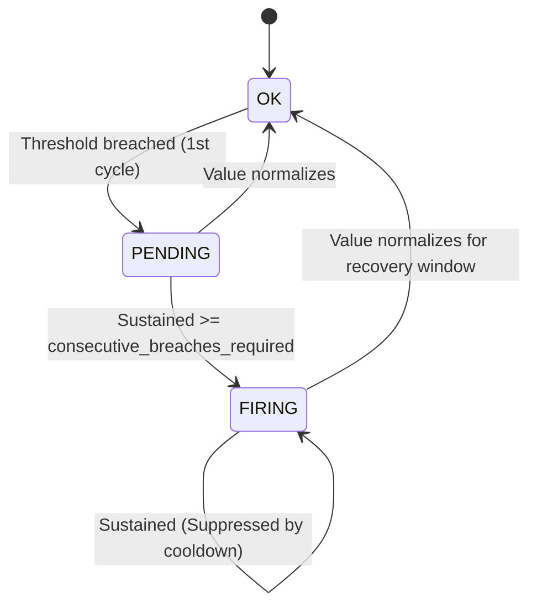

# NexusGrid Phase 6: Alert Evaluation State Machine & Notification Architecture

## 1. Alert Lifecycle Finite State Machine (FSM)



### Hysteresis & Anti-Flapping Principles:
- **Consecutive Breaches Required**: Rules require $N \ge 2$ consecutive breached evaluations before firing. This eliminates noisy paging caused by single-datapoint spikes.
- **Cooldown Window**: While in the `FIRING` state, repeated evaluations generate action `SUPPRESSED_BY_COOLDOWN` to avoid flooding operator webhooks or PagerDuty.
- **Deterministic Deduplication Key**:
  $$\text{DedupeKey} = \text{sha256}(\text{tenant\_id} + \text{":"} + \text{rule\_id} + \text{":"} + \lfloor \text{now} / \text{cooldown\_bucket} \rfloor)$$

---

## 2. Cryptographic Webhook Dispatch Verification

Webhooks are dispatched with an `X-NexusGrid-Signature` header computed using HMAC-SHA256:

```text
POST /webhook/receiver
Host: customer-api.example.com
X-NexusGrid-Signature: sha256=d58b9...
Content-Type: application/json

{
  "event": "ALERT_FIRING",
  "rule_id": "rule_err_spike_01",
  "rule_name": "High Error Rate (> 5%)",
  "tenant_id": "tenant_acme",
  "project_id": "proj_prod",
  "metric_name": "error_rate",
  "current_value": 8.5,
  "threshold": 5.0,
  "dedupe_key": "c7a8b9f123456789",
  "timestamp": "2026-11-02T12:00:00Z"
}
```

Receivers verify the signature using `crypto.timingSafeEqual` to prevent forgery and timing attacks.
