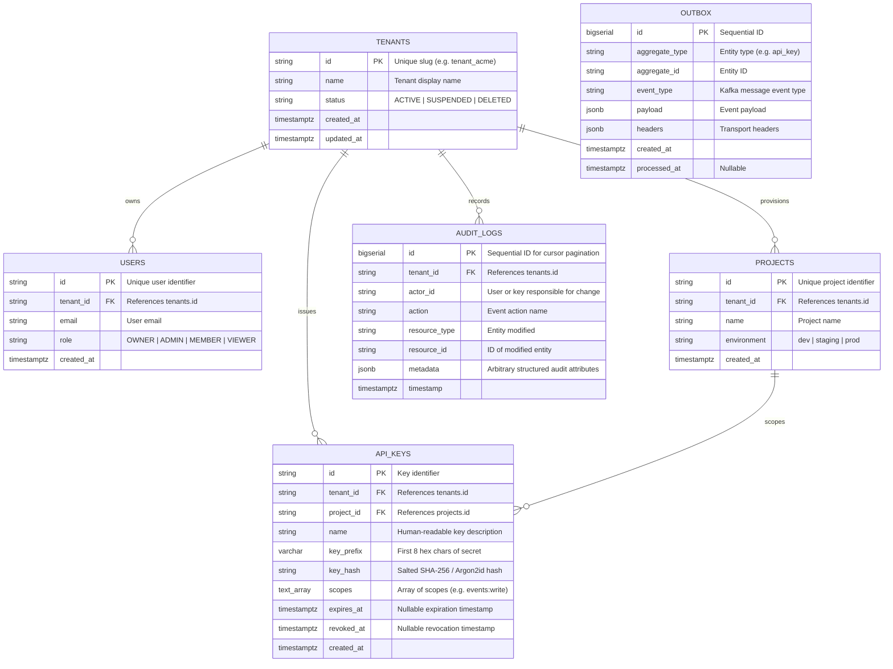

# NexusGrid Phase 1 Entity Relationship Diagram & Metadata Architecture

## 1. Relational ER Diagram

## 2. Composite Index Rationale & Access Patterns

1. **`idx_api_keys_lookup (key_prefix, tenant_id)`**:
   - In high-throughput ingestion, every API request presents an API key (`ng_live_<prefix8>_<secret32>`).
   - The gateway parses `prefix8` in O(1) time and performs an index lookup on `(key_prefix, tenant_id)`.
   - Result: Index Scan directly finds candidate hash without table scan.
2. **`idx_audit_logs_tenant_cursor (tenant_id, id DESC)`**:
   - Audit logs are read using cursor-based pagination: `SELECT * FROM audit_logs WHERE tenant_id = $1 AND id < $cursor ORDER BY id DESC LIMIT $limit`.
   - A single composite B-Tree traversal serves both the tenant equality filter and descending sort without intermediate sort buffers.
3. **`idx_outbox_unprocessed (id) WHERE processed_at IS NULL`**:
   - Outbox worker queries only unprocessed rows using `SELECT ... FOR UPDATE SKIP LOCKED`.
   - Partial index ensures only pending records are indexed, minimizing index bloat.

